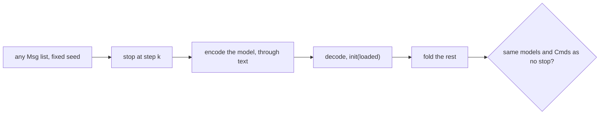

# 0226: In next/, every machine passes the sync test by default and leaves it only by name with a reason, with the helper in tea's pbt and a stopgap in libfabrika's test kit

**What this decides:** the one law that proves a saved and restarted machine is the same run.



```ts
// A sketch from the note: one law in tea's own Step shape.
syncTest(lane, { state: Lane, msgs: laneMsgs, seed: 190 });
```

## Context

Decided by the owner on 2026-11-01, S2 at 85% and where the helper lives at 70%. GGPO's sync test
rolls back every frame and raises an error if the two differ. On today's lane, 300 lists at seed
190, stopped at each of 2,783 steps, found 0 breaks; a planted field the schema drops broke 300 of
300 (experiment 190). See [saved state](../docs/direction/saved-state.md).

## Decision

**In `next/`, a machine's laws include the sync test by default, and a machine leaves it only by
name, with a reason.**

- The test: for any Msg list with a fixed seed, at every step, encode the model with its state
  schema through text, decode it, boot with `init(loaded)`, fold the rest, and compare every later
  model and Cmd with the run that never stopped.
- The helper belongs in tea's `@demlik/tea/pbt`, taking `encode` and `decode` as plain functions,
  so tea takes on no convention of ours.
- Until tea ships it, a stopgap lives in libfabrika's test kit (`Testing.ts`'s `syncTest`), deleted
  when tea has it.

## Consequences

- A model that holds a function, a Date or a cache fails it, rightly.
