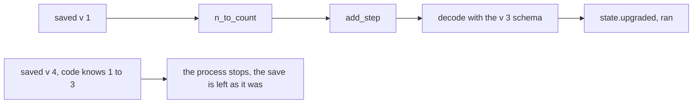

# 0227: In next/, saved state carries its shape's number v, its build and a chain of named upgrades, and older code meeting state from a newer fabrika stops and changes nothing

**What this decides:** how a saved model in `next/` crosses a change in its shape.



```ts
// A sketch from the note.
export const state = {
  v: 3,
  schema: Schema.Struct({ count: Schema.Number, step: Schema.Number }),
  upgrades: [
    { name: "n_to_count", from: 1, run: (m: { n: number }) => ({ count: m.n }) },
    { name: "add_step", from: 2, run: (m: { count: number }) => ({ ...m, step: 1 }) },
  ],
};
```

## Context

Decided by the owner on 2026-11-01: branch A at 60%, `build` beside each saved model at 85%. The
stop on a newer shape was decided on 2026-11-08 (P15). Every engine that carries state forward
numbers it (Minecraft, Unreal, Erlang's `vsn`, Factorio, Temporal), and hot reload makes a shape
change an everyday event. This walks back "no version number on each machine" for state carried
forward. See [saved state](../docs/direction/saved-state.md).

## Decision

**In `next/`, a saved model carries its shape's number `v` and its `build`, and a program's state
declares a chain of named upgrades, one per number; the schema is still the last check.**

- An old number climbs through each named upgrade in order, then decodes. Never a guessed upcast.
- The upgrade writes `state.upgraded` with the upgrades it `ran`.
- The saved model carries the `build` that saved it, so its shape can be worked out later from the
  code kept by hash.
- When code meets saved state whose `v` it does not know, because a newer fabrika saved it, that
  process stops. Nothing is deleted or rewritten. The tile says the state was saved by a newer
  fabrika and offers Restart after an update. There is no downgrade chain.

## Consequences

- Built in `runtime/State.ts`.
- Why only 60%: most shape changes may be additive, which needs no number. If in Tier 1's first two
  weeks no process crosses two shapes at once, reopen it for the schema alone.
