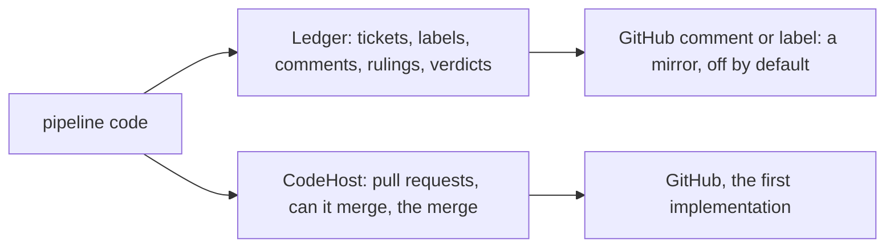

# 0231: The record goes through the Ledger service and the code side through CodeHost, two services, never a direct gh call, and Ledger has no GitHub in it, so a GitHub comment or label is only a mirror

**What this decides:** which service a call that once went to GitHub goes through.



```ts
// From the note: which side a call is on.
Ledger.comment(ticket, text); // local files could hold it            -> Ledger
CodeHost.mergeable(pr); // only the place holding the branches  -> CodeHost
```

## Context

Decided 2026-10-11, with `Ledger` designed with no GitHub in it on 2026-10-12. On 2026-10-24 the
owner said again that the end state is fabrika's own tracker. See
[the ledger sits behind a service](../docs/direction/ledger-behind-a-service.md) and
[the backend is a library](../docs/direction/backend-as-a-library.md). AGENTS.md says to talk to
typed services, never to a command-line tool.

## Decision

**GitHub sits behind Effect services as their first implementation, and GitHub's two jobs get two
services: `Ledger` for the record and `CodeHost` for the code.**

- The test for a call: if the ledger were local files, would this still have to come from wherever
  the code is hosted? If not, it is `Ledger`.
- `Ledger` is designed with no GitHub in it. Tickets, criteria, questions and answers, and review
  results follow our own contract; GitHub is one backend added after.
- `CodeHost` may stay shaped like GitHub. It holds the code and performs the merge it is told to;
  the merge queue is fabrika's own ([0107](0107-fabrika-provides-the-merge-queue.md)).
- New code makes no direct `gh` call.
- Agents and people talk through fabrika's own ledger. A GitHub comment or label is only a mirror,
  off by default, and nothing is built on GitHub issues.

## Consequences

- The names are working names. Where a review verdict lives, and whether `Worktrees` joins
  `CodeHost`, are open.
- In today's version `Ledger` belongs to tea-host, which gives it to the programs it runs; in
  `next/`, the ledger is libfabrika's `ledger/` module.
