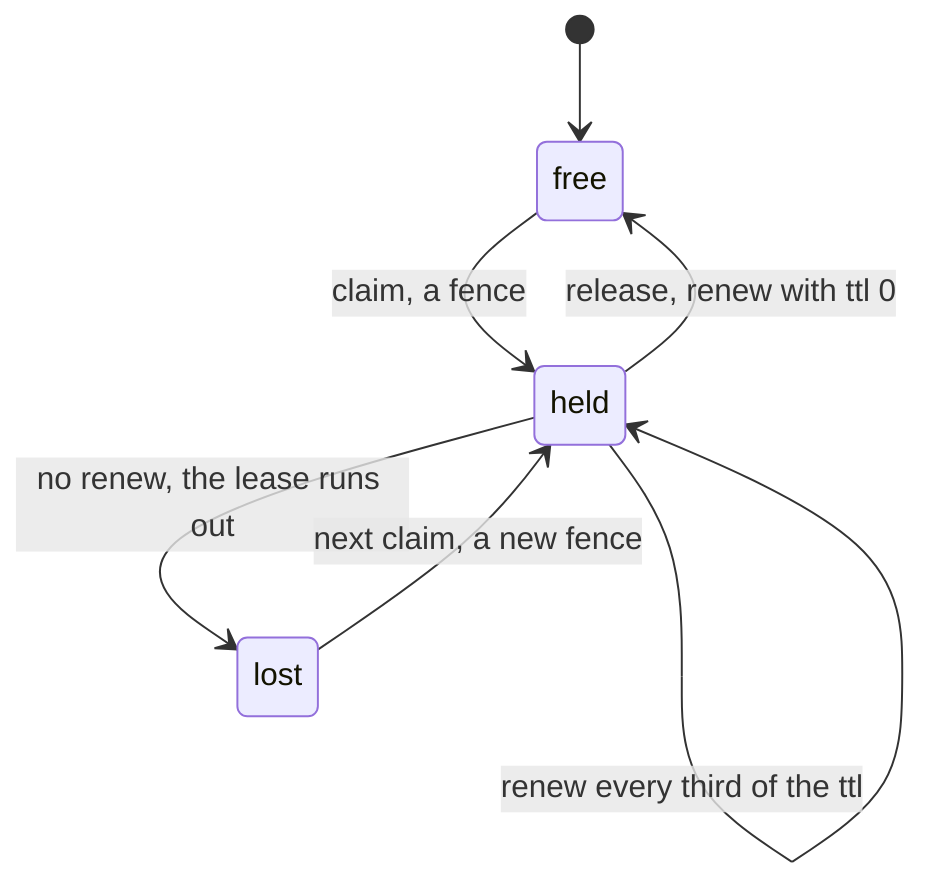

# 0232: In today's pipeline, a ticket's claim is the ledger's lease, the first claim wins until released or lost, and a lost lease fences every write of the old holder

**What this decides:** how today's pipeline keeps two lanes off one ticket.



```ts
// From the note: the ledger's own calls on pipeline/ticket/<ticket>.
ledger.claim(name, lane, rev, ttlMs); // -> a fence, or Held { holder }
ledger.renew(name, fence, ttlMs); // every third of the ttl, from the holder's process
ledger.renew(name, fence, 0); // release: the lease ends at once
```

## Context

Built as facts on 2026-10-18, and since 2026-10-21 (experiment 110) a claim is the tea-host
ledger's lease on the ticket's name, in `packages/pipeline/src/asks/claims.ts`. Experiment 91 found
two lanes working one ticket and a failed head landing. See
[the ledger sits behind a service](../docs/direction/ledger-behind-a-service.md).

## Decision

**In today's pipeline, a ticket's claim is the ledger's lease on its name: the first claim wins
until it is released or lost.**

- Who holds a ticket is the lease, kept nowhere else. A later claim is told who holds it.
- The claim is the ledger's compare-and-set, so two processes that both see the ticket free cannot
  both claim it.
- A lost lease fences the old holder: every write under the old fence is refused.
- A lane started again after a crash, as the same lane, waits its old lease out and claims again.
- The loop claims first and lets go before it ends. Build and ship refuse a lane that does not hold
  the ticket; a loop that finds it held ends `skip:claimed`, and one that cannot read the ledger
  ends `stuck:claim`.

## Consequences

- With the claim, experiment 91's two-lane worlds keep every law.
