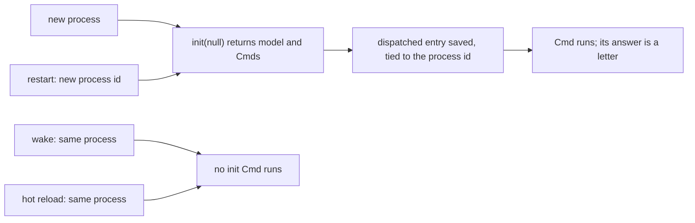

# 0253: In next/, a program has no main, and the Cmds its init returns run once per process start, never on a wake or a hot reload, each saved as dispatched before it runs

**What this decides:** when the setup work a program's `init` asks for runs, and what the ledger
keeps so a woken process knows it already asked.



```text
start   process_A   init -> 1 Cmd   dispatched process_A/init/0, runs, answer is a letter
wake    process_A   no Cmd runs     process_A/init/0 is already on the record
reload  process_A   no Cmd runs     new code, same process
restart process_B   init -> 1 Cmd   dispatched process_B/init/0, runs
```

## Context

Decided in [init runs once per process](../docs/direction/init-runs-once-per-process.md), following
Elm's `init` and OTP's `gen_server:init/1`. Tracker ticket 292 builds it.

## Decision

**A program's logic is a machine that libfabrika's runner steps, and its init's Cmds run once per
process start.**

- A program has no `main`. Its logic is a machine, and the runner owns the loop.
- The runner runs the Cmds `init` returns once per process start. A restart is a new process, so it
  runs them again.
- A wake or a hot reload runs no init Cmd, even when the new code's `init` returns different ones.
  A person who wants them presses Restart.
- Each init Cmd's dispatched entry is saved before the Cmd runs, tied to its process id. One with
  no answer stays dispatched and is never fired again: the runner does not guess.

## Consequences

- A wake can tell "never ran" from "ran, answer lost", which it could not rebuild later.
- Setup is paid on every restart; the restart brake bounds a crash loop, not the cost.
- Not decided: whether an init Cmd must finish before the first input is stepped.
