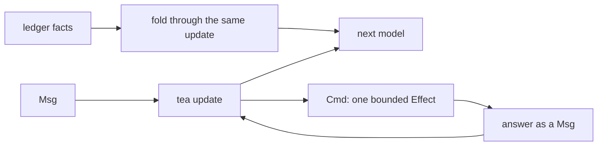

# 0254: In next/, tea is the one engine that holds state that moves, so no Effect Workflow, replay engine or actor runtime replaces a tea machine, and a Cmd is one bounded Effect whose answer is a Msg

**What this decides:** which library holds "where are we" for a turn, a lane, a lease or a program
in `next/`: always a tea machine, with Effect underneath its Cmds.

## Context

Decided by the owner in [tea is the engine](../docs/direction/tea-is-the-engine.md), from
experiment 174, which ran an agent turn on Effect's `Workflow` and found two durable models side by
side. [Build on Effect](../docs/direction/build-on-effect.md) names this as its one exception
([0250](0250-effect-modules-first-node-at-an-edge.md)).

## Decision

**Every piece of state that moves is a tea machine, and what survives a sleep or a kill is its facts
folded through the same `update`.**

- Nothing replaces a tea machine. A library that would hold a machine's state or decide its next
  step does not come in.
- Banned: Effect's `Workflow` (with `Activity`, `DurableClock`, `DurableDeferred`) and any
  `WorkflowEngine`; any replay engine that re-runs code outside a tea fold; any actor runtime that
  keeps state for us, such as cluster's `Entity` and `Sharding`.
- Allowed: Effect as the engine under tea's Cmds and Subs. A Cmd may be any Effect, as long as it is
  one bounded job and its answer comes back as a Msg. Effect services and Layers, and Effect modules
  that hold no state of ours (Schema, RPC frames, SQL clients, Stream inside one Cmd), stay.
- Ideas from cluster and `Workflow` may be copied into tea machines (dedup by request id, a message
  kept before delivery, at-least-once with a dead letter), never their code or their state.
- Effect's cluster comes back only with a written reason in a note that names what it would undo.

## Consequences

- A durable agent turn is ours to write as a machine.
- What would change it: a real job a tea machine cannot hold without a pile of glue, or cluster able
  to sleep on a Durable Object with no polling, written as a reason first.
