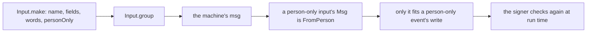

# 0258: In next/, a program's inputs are plain data its Msg is built from, "input" means a write, and personOnly true is the one way to say person-only, branded FromPerson for tsc

**What this decides:** what an input is in a program's shape, and how a program says that only a
person may send one.



```ts
const answer = Input.make("answer", {
  fields: Answer.fields, // plain data: no events on an input
  description: "Answer an open ask on the ticket shown.",
  personOnly: true, // only `true`; left out, anyone
});
const inputs = Input.group([show, comment, answer, close, reopen]);
export const ticketMachine = Machine.make({ model: Model, msg: inputs /* ... */ });
```

## Context

Decided by the owner in [a program's shape](../docs/direction/program-shape.md), part of
[0257](0257-a-programs-api-has-one-way.md)'s pick. Ticket 302 builds it. Today's version is not
changed.

## Decision

**An input is plain data, and the program's Msg is built from its inputs.**

- An input is its name, its fields and its words. It never names the events it may cause, and it is
  never a key matched to a Msg type, so a Msg no client can send cannot be written.
- "Input" means a write. A read port gets its own word, picked with the first program that needs
  one.
- `personOnly: true` is the one way to say person-only, on an input and on an event. Only `true` is
  allowed; left out means anyone. Never `who: "person"` and never `personOnly: false`.
- A person-only input's Msg is branded `FromPerson` (Effect's `Schema.brand`), and a person-only
  event's write takes only a Msg with that brand, so tsc lets nothing else in.
- A brand stops a mistake, not a forger: the signer stays the real check.

## Consequences

- A plain input writing a person-only event fails to compile, where today's shape refuses it only
  when the write runs.
- The doubt: how the brand reads in a tsc error to someone who did not write it.
