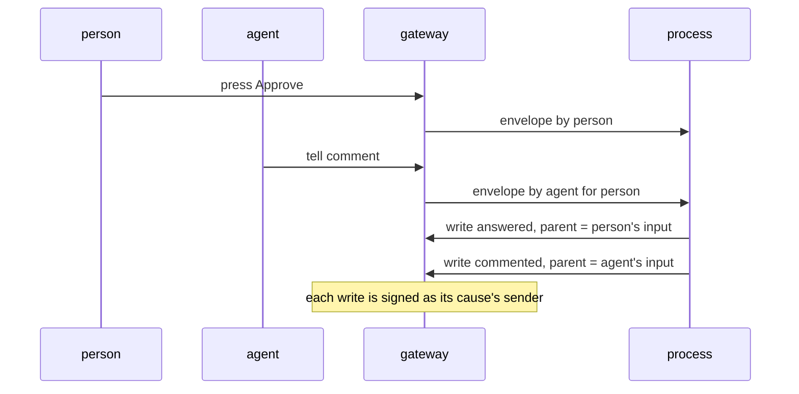

# 0261: Every input carries its sender, stamped at the door, and every write carries the input that caused it in the data, so an agent signs its own writes and never the person's

**What this decides:** who signs a write when a person and an agent both act in one running program:
each write is signed as the sender of the input that caused it.

## Context

The direction set by the owner in
[inputs carry their sender](../docs/direction/inputs-carry-their-sender.md), design D of the shared
tile study. The note is written for today's version (the host's door); `next/` takes the same rule
at its gateway ([0051](0051-gateway-connection-and-node-by-job.md)), where a run is a process.
[0262](0262-a-write-carries-parent-and-traceid.md) names the links and the signing service.

## Decision

**Inputs carry their sender, and each write is tied to the input that caused it, with the cause in
the data, never in the call stack.**

- The door stamps every input as an envelope. Today's version: `Envelope<A> = {id, by, at, input}`.
  `next/`: `{id, by, arrivedAt, input}`, with the referee's clock named as the owner renamed it
  (2026-11-05). Nobody sends their own id or sender.
- A program carries the cause in its Msg, in any queue in its Model and in the Cmd's input; it never
  carries the sender. The door looks the sender up.
- A trace mirrors the cause with an OpenTelemetry span link. A trace never decides who signs.
- Delegation, never impersonation: an agent signs its own writes and never the person's, and keeps
  both ids, as `agent:claude for:<person>`.
- A person's press in an agent's job is never run as the person's own one-shot job.
- Record first: who sent each input is recorded in the log before any write uses it, never what a
  raw key said.

## Consequences

- One owner per job, one signer per write.
- A program that forgets the cause gets a wrong signer, not an error; the test-kit law in
  [0263](0263-a-writes-signer-is-its-causes-sender.md) holds that.
- Not decided here: a client-sent `id` or `by` being refused and recorded, and a write with no cause
  being `own`. Both are still proposed in the note.
  Decided in [0140](0140-gateway-refuses-client-id-and-by.md): refused and counted, never kept, and `own`.
