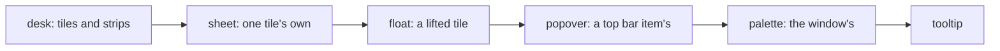

# 0264: The frame draws a few named layers in one fixed order, desk, sheet, float, popover, palette, tooltip, each with an owner it goes with, and no program picks a z-index

**What this decides:** what can sit on top of a tile, in which order, and when it goes away.



```ts
// A sketch, next/. Low to high; the frame draws them in this order.
type Layer =
  | { _tag: "desk" }
  | { _tag: "sheet"; tile: TileId }
  | { _tag: "float"; tile: TileId }
  | { _tag: "popover"; item: string }
  | { _tag: "palette" }
  | { _tag: "tooltip"; for: string };
```

## Context

Decided by the owner after a walk, in [layers](../docs/direction/layers.md) (L1, L2), from
experiment 207. These are the frame's drawing layers, not a library's layers
([0091](0091-modules-and-layers.md)). Today's app builds them first; `next/` gets all of it with
tezgah in Tier 2.

## Decision

**A few named layers, one fixed order, owned by the frame.**

- Low to high: desk, sheet, float, popover, palette, tooltip. No program picks a z-index; a program
  says "a sheet" and the frame places it. A lint refuses `z-index` outside the frame's own layer
  block (80%).
- Every layer has an owner and goes when its owner goes, so no layer outlives its tile. A tile that
  closes, folds or is hidden by a zoom takes its layers with it (80%).
- A sheet belongs to one tile. A float, a popover, the palette and a tooltip are desk-wide.
- A float is a whole tile lifted, and only when the person asks for it.

## Consequences

- Each layer gets a law that it does not outlive its owner, and the lint.
- Not decided: whether a sheet sits under or over a float (lean under), and what the ledger records
  about layers (proposed).
