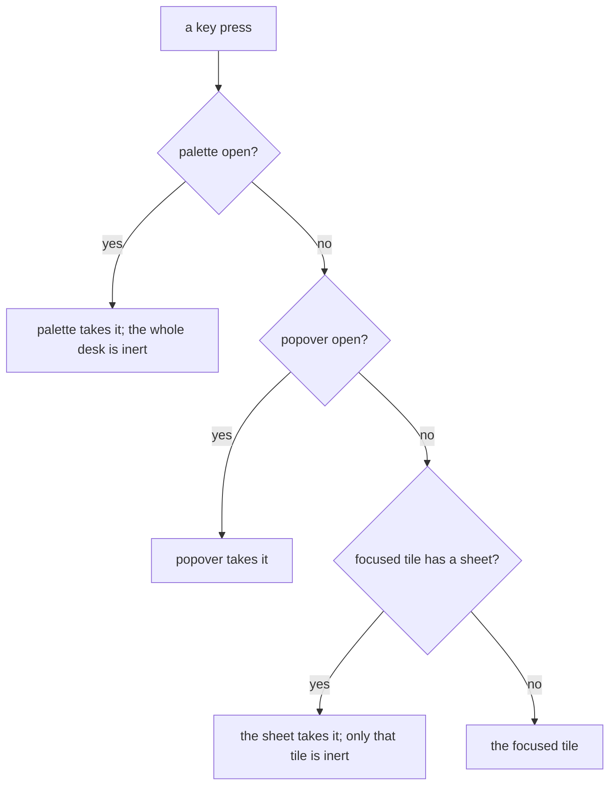

# 0265: What is on top and who takes the keys are two facts the status bar says, one modal at a time sits on its smallest owner, Esc closes only the top layer, and nothing covers the focused tile

**What this decides:** where keys go while a layer is open, what is inert under it, and how a
person gets back.

## Context

Decided by the owner after a walk, in [layers](../docs/direction/layers.md) (L3, L4, L5 and call
4). The prefix and F6 rule matches the one for modes in
[0270](0270-escape-always-leaves-a-mode.md). Today's app builds it first; `next/` in Tier 2.

## Decision

**Who takes the keys is said in words, and getting out is always one `Esc`.**

- What is on top and who takes the keys are two facts. The status bar names the layer that takes
  the keys, as a mode's word is named: `PALETTE`, `SHEET · on t2` (80%; 65% on the words).
- The prefix and F6 reach the desk under every layer, never taken as tmux's modal pane takes them
  (WCAG 2.1.2).
- One modal at a time, on the smallest owner. The palette is the one desk-wide modal; a program's
  modal is a sheet on its own tile, and only that tile is inert under it (60% on the tile scope).
- The whole desk is inert under the palette (90%; ticket 203).
- `Esc` closes the top layer and nothing else, and focus goes back to the opener (85%).
- Nothing covers what you are working on: a layer that leaves the keys below never covers the
  focused tile or row (WCAG 2.4.11; 80%).

## Consequences

- One pure function decides where a key goes (today's `keyGoesTo`), with a case and a test per
  layer, and a box check in tests for the covering rule.
- Needs a real screen reader run: the sheet, the inert desk and the layer words.
