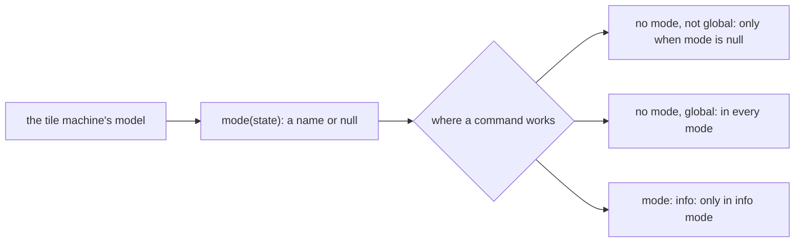

# 0267: In next/, a program declares its keys as one commands field and its mode as one mode read from its tile's own state, never null as a named base mode, and every command name carries its program's name

**What this decides:** the shape a program uses to say what its keys do and which mode it is in.



```ts
// A sketch, next/, Tier 2.
const desk = Program.make({
  name: "desk",
  mode: (d: Desk) => (d.info._tag === "on" ? "info" : null), // read from state, never a flag
  commands: {
    info: { send: { type: "info" }, keys: "<prefix>i", global: true },
    exit: { send: { type: "info", active: false }, keys: "escape", global: true, mode: "info" },
  },
});
```

## Context

Decided by the owner after a walk, in [modes](../docs/direction/modes.md) (the shape and M2), from
experiment 184. The command names and the `mode` field's name were decided before that walk. The
glossary's `mode` row says the same. Today's version is not changed.

## Decision

**One field, `commands`, and one `mode`, read from state.**

- A program gets one field, `commands`: each is its Msg (`send`), its keys, and optional `global`
  and `mode`. Never separate keys, global, modes or actions fields.
- A command's field for where it works is `mode`, the same word as the program's `mode`.
- Every command name carries its program's name, as `desk.split`.
- A mode is model state in the tile's own machine, read by `mode(state)`, never a window flag or set
  from outside, so one person's mode never moves another's view (75%).
- `send` is a Msg for the tile's machine; a program with no tile machine takes its program Msg
  directly.
- No mode is `null`, and fabrika never names a base mode.
- A command with no `mode` works only when its program has no mode, and a `global` one works in
  every mode (75%).

## Consequences

- Any program with a mode needs a tile machine.
- The doubt: a mode that only adds keys, as Linear's select, makes every tile command say
  `mode: [null, "select"]`. A real list program with select settles it.
