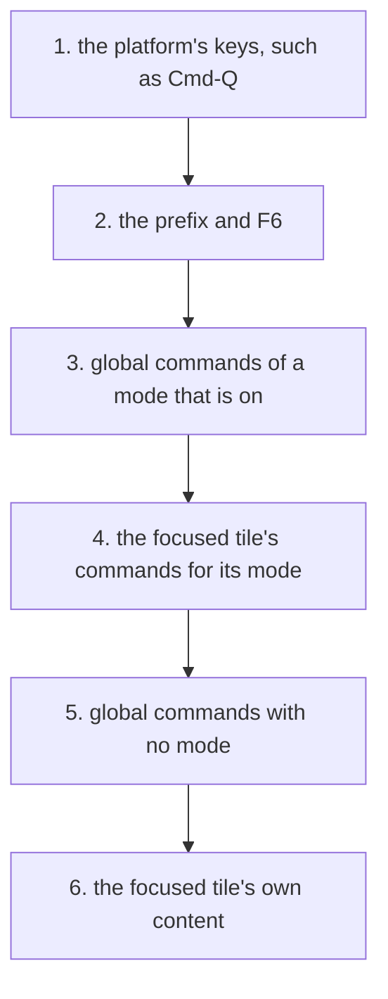

# 0272: A key press finds its command in six fixed steps, the platform's keys first and the tile's content last, and the desk may have modes of its own that win over the focused tile

**What this decides:** the one order every key press is matched in.

## Context

Decided by the owner in [modes](../docs/direction/modes.md) (how a press finds its command, and
whether the desk can have a mode). Step 4 before 5 is PR 282's rule. The desk is tezgah's program,
Tier 2. `next/`; today's version is not changed.

## Decision

**Six fixed steps, the first match wins (70%).**

- The order: the platform's keys (never ours); the prefix and F6; global commands of a mode that is
  on; the focused tile's commands for its mode; global commands with no mode; the tile's content.
- Each command is checked against its own program's mode, so `palette.open` works while notes is
  editing, and a letter key does not fire in a text box.
- A key no command takes goes to the tile's content.
- The desk may have modes of its own, such as info and resize, and a window-wide mode wins over the
  focused tile (75%). The prefix still works in them.

## Consequences

- One test per step of the router.
- The doubt: in desk info mode, Escape no longer reaches a tile, so a shell with vi keys loses it.
