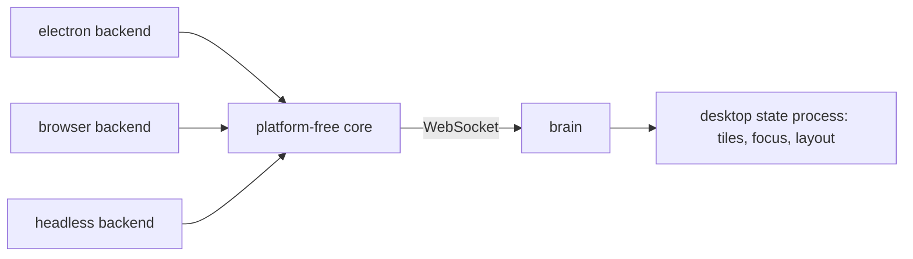

# 0274: In next/, the desktop layer is one platform-free core with electron, browser and headless backends, every window dials the brain over a WebSocket, and the desktop's own state is a process in the brain

**What this decides:** how the desktop (layer 5, Tuval) stays the same on Electron, in a browser tab
and in tests.



```ts
// A sketch. A window is a client: it picks a workspace and says which keys it cannot have.
type Window = { platform: "electron" | "browser" | "headless"; workspace: 1; cannot: Key[] };
```

## Context

Decided by the owner in the five-layers walk, in
[the desktop layer](../docs/direction/the-desktop-layer.md) (W1), changed for `next/` on 2026-11-01.
The desktop process is tezgah's (the glossary's word; the note said `fabrika/desk`). The local
runtime is used through Alchemy ([0042](0042-platform-pieces-go-through-alchemy.md)).

## Decision

**One core, three backends, and the state in the brain (80%).**

- The desktop layer is one platform-free core with `electron`, `browser` and `headless` backends,
  never tied to one platform, as wlroots and VS Code split theirs.
- Every window dials the brain over a WebSocket, so the backends differ only in screen things.
- The desktop's own state (tiles, focus, layout) is a process in the brain, as a tmux server holds
  sessions any client attaches to, never the window's.
- A platform quirk is first checked against how apps that ship on both platforms handle it, before
  we invent a fix.

## Consequences

- Like every layer, it must run in a browser tab.
- A desktop process in the brain, where today's app keeps the layout.
