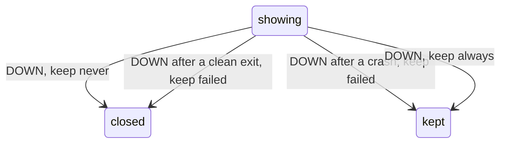

# 0276: In next/, a tile shows one process, monitored as OTP monitors, and on its exit follows its keep, never, failed by default, or always

**What this decides:** what a tile does when the process it shows ends.



```ts
type Tile = { id: "t3"; shows: ProcessId; keep: "never" | "failed" | "always" };
```

## Context

Decided by the owner in [the desktop layer](../docs/direction/the-desktop-layer.md) (W3). tmux's
`remain-on-exit` has the same three. The monitor's letter names its `reason`
([0081](0081-no-question-word-names.md)); the note's sketch says `why`.

## Decision

**A tile shows one process and follows its `keep`.**

- The desktop monitors the process a tile shows, as OTP monitors one.
- On the process's `DOWN`, the tile follows its `keep`: `never` closes it; `failed`, the default,
  keeps it only after a crash, with the last view and the reason; `always` keeps it, for test runs.

## Consequences

- A crash's reason, already recorded, reaches the desk too.
- Open, on P18's row in Tier 1: since a restart is a new process, whether a tile watches the
  registered name or monitors the successor again.
