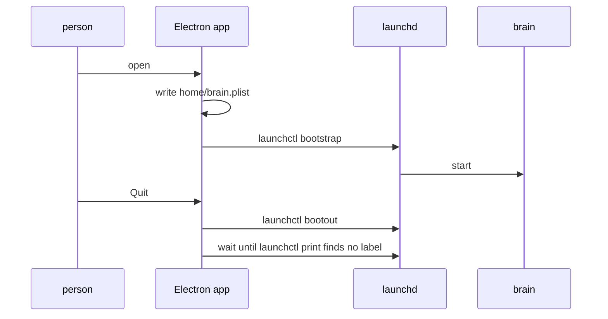

# 0280: In next/, a person only opens the app, which starts the brain as a plain launchd service with its plist in the app's home, the menu bar is part of the Electron app from the first slice, and Approve and Remove ask for a finger

**What this decides:** what a person has to start to use fabrika on a Mac: only the app.

## Context

The owner settled the shape on 2026-11-01, in
[the desktop layer](../docs/direction/the-desktop-layer.md#the-app-and-its-menu-bar), with Tier 1's
plan. P4 (experiment 214) showed launchd works from an unsigned build, so the child-process way out
is not needed. The note's `cloud` stage is the cloud instance
([0080](0080-a-running-copy-is-an-instance.md)).

## Decision

**One thing to open, so nobody manages a service by hand.**

- A person only opens the app, and the app starts the brain.
- The menu bar is part of the Electron app from the first slice.
- The brain is a plain launchd service, with its plist in the app's home, so nothing starts at
  login. It sits behind one brain service, with a launchd layer and a test layer. From 2026-11-13
  the app itself may open at login, behind one setting that is off by default
  ([0182](0182-the-app-file-and-start-at-login-are-in-p19.md)); the brain is still started by the
  app.
- Approve and Remove ask for a finger. Deny never does: saying no should be easy.
- On the cloud instance the app starts no brain and keeps only its link.

## Consequences

- The brain outlives an app crash.
- `bootout` returns before the job is gone, so Quit waits for the label to disappear.
