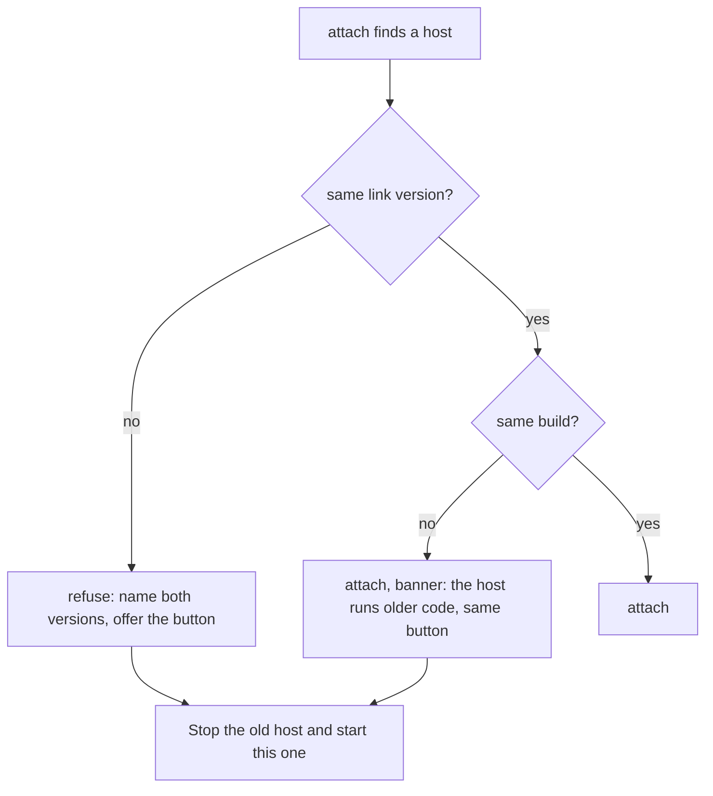

# 0282: In today's version, an app that meets a host on another link version refuses, names both and offers one Stop-and-start button, and on another build attaches with a banner and the same button

**What this decides:** what today's app does when it finds an older host still running on its home.

## Context

Decided by the owner in
[an old host is named, then restarted](../docs/direction/an-old-host-is-named-then-restarted.md)
(sections 2 and 3), built 2026-10-26. Today's version only; in `next/` a program change restarts
nothing ([0291](0291-hot-reload-swaps-one-program.md)).

## Decision

**Say it plainly, then offer the one fix.**

- On another link version, the app refuses, names both versions ("The host speaks link version 1.
  This app speaks 2."), and offers one button: "Stop the old host and start this one". Never a new
  host beside the old one.
- Reconnect never retries a refused host.
- The host's hello names its build. On another build the app attaches anyway, with a "the host runs
  older code" banner and the same button. It never refuses another build: every pull would stop
  every job.
- Later: today's host restarts itself onto the new build when no job runs.

## Consequences

- The button stops running jobs; each comes back with `attach %n`, through the state check
  ([0281](0281-a-saved-job-is-decoded-not-trusted.md)).
- Whether a job sends a call again after the restart is each kind's own `recovered` Msg, not the
  restart's.
