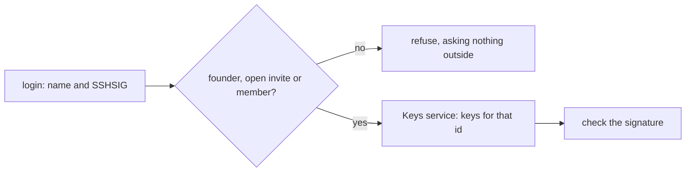

# 0284: In today's version, the door asks a keys service which keys may sign for a person and never calls GitHub itself, access starts from an invitation, and a person proves who they are by an SSH signature

**What this decides:** how a person gets into a shared ledger in today's version.

## Context

Decided by the owner in
[the ledger goes to Cloudflare](../docs/direction/the-ledger-goes-to-cloudflare.md) (the top and
section 1). Today's version only: for `next/`,
[a key per client](../docs/direction/a-key-per-client-and-no-github-trust.md) (2026-11-05) rules
GitHub out as a way in, and a person joins by invite and approval.

## Decision

**The door asks one keys service, and only about someone the ledger already knows.**

- Where a person's keys come from is an Effect service the door asks. The door never calls GitHub
  itself; GitHub is only the service's first layer, and a person's id comes from the service too.
- Access starts from an invitation. The door asks the keys service only about someone this ledger
  knows: the founder, an open invite or a member. Any other name is refused without asking outside.
- An invite binds a name to an id once; after that, sign-in goes by that id.
- A person proves who they are by an SSH signature over the door's challenge, checked against every
  key GitHub lists for their login, read again at each login. No key pinning.

## Consequences

- A sign-in anyone can start spends no budget outside the ledger.
- A person keeps their GitHub key list clean; a removed key stops working within one session.
