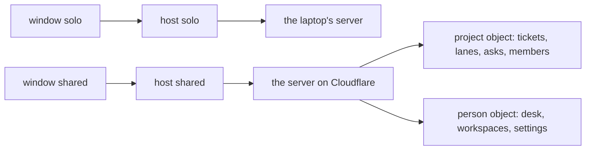

# 0285: In today's version, a project lives on one ledger server of many Durable Objects, one per project and one per person, never a local copy beside a remote one, and every client reads and writes that one server

**What this decides:** where a project's facts live and how a window and a host reach them.

## Context

Decided by the owner in
[the ledger goes to Cloudflare](../docs/direction/the-ledger-goes-to-cloudflare.md) (the top and
section 3), and built in today's version. "Host" is today's word here; in `next/` a running copy is
an instance ([0080](0080-a-running-copy-is-an-instance.md)), and this file does not decide `next/`'s
shape.

## Decision

**One project, one server, many objects.**

- A project lives on one ledger server: on the laptop by default, or on Cloudflare. Never a local
  copy beside a remote one.
- The app opens several projects the way Obsidian opens vaults, each in its own window.
- Each open project gets its own host, with its own jobs, history and programs, so every host still
  uses exactly one ledger.
- A ledger server is many Durable Objects from the start: one per project for shared work, and one
  per person for that person's desk, workspaces and settings.
- Every client reads and writes the one server, and nothing syncs between clients. A project's
  object is shared whole, with no list per program.

## Consequences

- A new program needs no line here: every stream in a project goes with it.
- A crash of one project's host shows only in its window.
