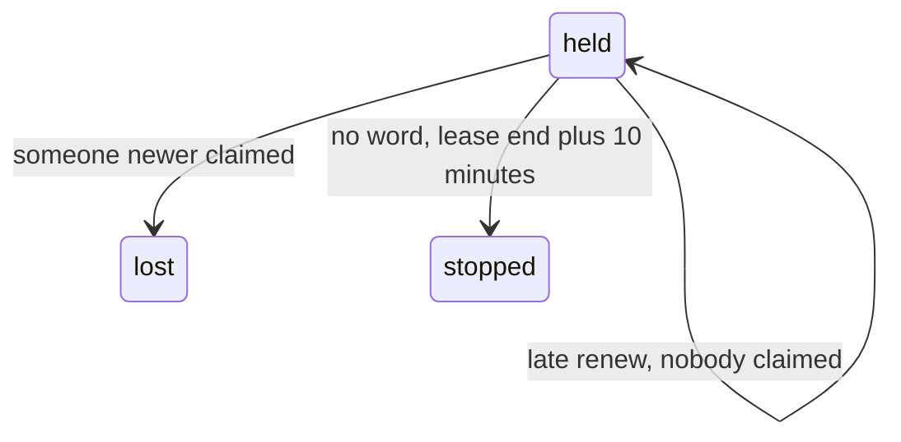

# 0287: In today's version, a lane rides out a wifi blip, a fenced write stays good until someone newer claims, never because time passed, and the host stops at the lease's end plus 10 minutes

**What this decides:** what happens to a lane when its laptop loses the network for a while.

## Context

Decided by the owner in
[the ledger goes to Cloudflare](../docs/direction/the-ledger-goes-to-cloudflare.md) (section 5),
after experiment 149, and measured in experiment 151: every drop up to 5 minutes kept the lane while
nobody else wanted it (474 of 474), and nothing landed twice in 1,090 runs.

## Decision

**The first version rides out a wifi blip; a laptop that stays offline for long waits.**

- Riding it out means the lane keeps its ticket and does not restart, its writes land once and in
  order, and the window says plainly what happened.
- The ledger follows Kafka's rule: a fenced write is taken while its fence is the newest one given
  out for that lease, at any time. The clock plays no part.
- A claim past the lease's end takes it at once with a bigger fence, so a dead host frees its
  ticket as fast as before. A late renew with the newest fence works while nobody claimed.
- The 30 s lease stays. The host treats no word from the ledger as not yet lost, and stops at the
  lease's end plus 10 minutes.

## Consequences

- Long offline work, a checked-out lane, is kept for later.
- The doubt left: experiment 151 ran on loopback, not a real wifi drop.
