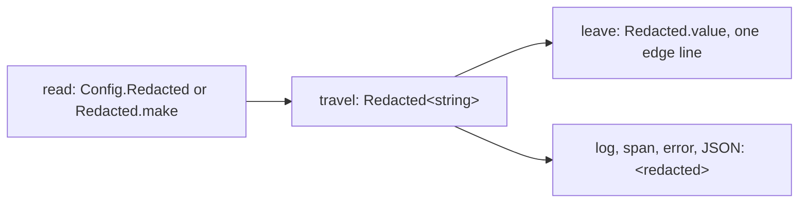

# 0320: Every secret is an Effect `Redacted` from its read to the one line that sends it out, never a plain string or a wrapper of ours



```ts
const key = yield* Config.Redacted("TYPESAFE_API_KEY"); // Redacted<string>
yield* Effect.log("calling Jev with", key); // "calling Jev with <redacted>"
headers.authorization = `Bearer ${Redacted.value(key)}`; // the one line that sends it
```

**What this decides:** how a secret is read, carried and sent, in both versions, so it cannot
reach a log, a trace, a saved state or a comment by accident.

## Context

fabrika builds public repositories too, so anything it writes may be read by anyone. From
[secrets are Redacted](../docs/direction/secrets-are-redacted.md#what-was-decided).
[0024](0024-next-records-with-spans-and-log-lines.md) holds the log line case and
[0069](0069-choices-are-settings.md) the settings case; this file holds the general rule.

## Decision

**Every secret is an Effect `Redacted` from the moment it is read.**

- Read it with `Config.Redacted("NAME")`, or wrap it with `Redacted.make` at the read when it comes
  from somewhere else: a request header, a Worker binding, a file.
- It travels as `Redacted.Redacted<string>`: a service's input, a Layer's option, an error's field.
- A schema keeps it as `Schema.Redacted(Schema.String)`, or, for a value read off the wire,
  `Schema.RedactedFromValue(Schema.String, { disallowEncode: true })`, so encoding fails rather
  than write the text.
- `Redacted.value` appears only on the line that sends the secret out: a header, a socket's
  subprotocol, a child's env, the file it is kept in, a login's answer to the one who logged in.
- A one-way hash of a secret (SHA-256) may be a plain string.
- Effect's own `Redacted`, never a type of ours: Effect's loggers, `Cause.pretty`, HTTP client and
  OpenTelemetry bridge already know it.
- Code holds this, never a written rule: the types, and two blocking lint rules,
  `fabrika/no-secret-env` (a secret-looking `process.env` read) and `fabrika/no-redacted-value`
  (`Redacted.value` off an edge).

## Consequences

- Every new secret costs a `Config.Redacted` read and one marked edge line.
- Tests may read a made-up secret back with `Redacted.value`; the second rule leaves tests out.
- Not decided here: how an edge line is marked, by a file listed in `.oxlintrc.json` with its
  reason or by a reasoned disable comment at the line. Both are in use today.
