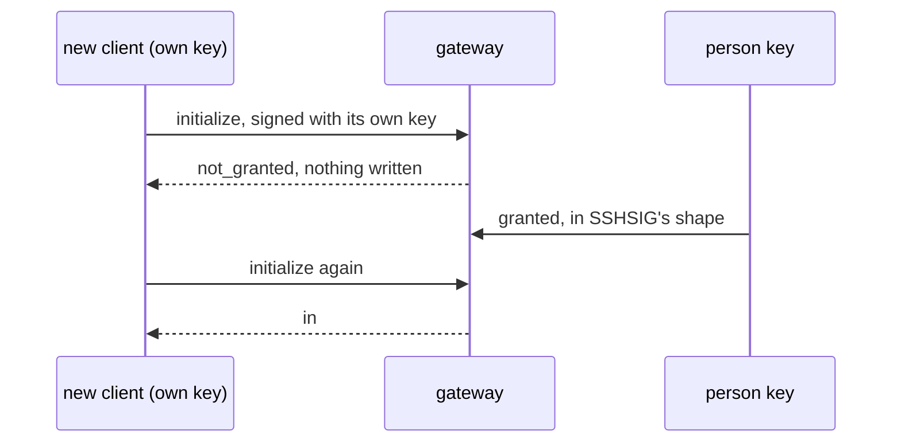

# 0322: In next/, each client signs in with its own key and the person key grants it, and GitHub is never a way in



```ts
// A sketch. Each client its own key; one yes from the person key; no third party.
{ _tag: "granted", key: tab.publicKey, for: person, as: "window", signed: sshsig(personKey, text) }
```

**What this decides:** every way into a fabrika in `next/` is a grant signed by the person key,
and no outside account's key list counts as one.

## Context

It answered Tier 1's open question 10. From
[a key per client, and GitHub is never a way in](../docs/direction/a-key-per-client-and-no-github-trust.md).
[0102](0102-hands-is-a-grant-rank-and-work-is-taken.md) later added `hands` as a third grant kind
beside `window` and `agent`. Today's version keeps its GitHub sign-in until `next/` replaces it.

## Decision

**One check at the gateway: a client's own key, granted by the person key.**

- Each client signs `initialize` with its own key pair: a browser tab's WebCrypto key, an Electron
  window's or the menu bar's sealed key, an agent bridge's own.
- The person key grants each new client, in SSHSIG's shape, the one check the gateway already makes.
  A revoke is one event.
- A key is never let in because GitHub lists it for a login. GitHub's key list is at most a way to
  look up a public key that a person then approves, never a pass in.
- A second person joins the way a new tab does: an invite, then an approval, which is the grant.
  No new way in.
- `next/` depends on GitHub as little as it can. GitHub stays the code host, reached through a typed
  service. Who may be in a fabrika is the fabrika's own fact, never GitHub's.

## Consequences

- A new machine gets one Approve from a client already in, or uses the recovery sheet
  ([0328](0328-a-device-comes-back-by-sheet-or-email.md)), instead of a GitHub key.
- Tier 3's join flow cannot take names from GitHub logins; a person types them.
- Not decided here: whether a GitHub key lookup is worth building at all.
