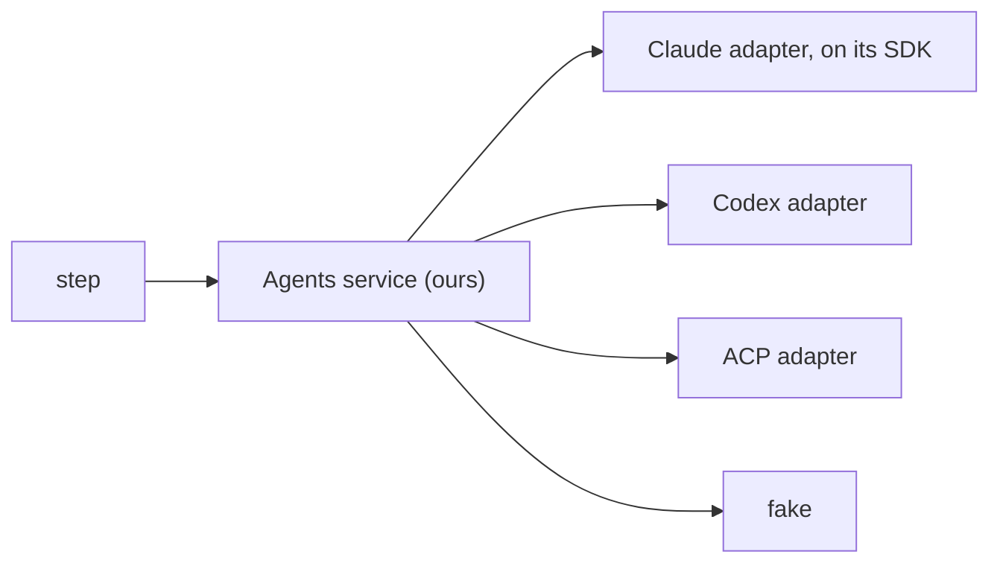

# 0325: Every step reaches an agent only through one Effect service of ours, with providers as settings in one table, never a maker's SDK imported by a step



```ts
// A sketch. A step asks the same way for every provider, and never names a maker.
const drafted = yield* Agents.run({
  prompt, folder, schema: BuildAnswer, session,
  provider: settings.build.provider, // "claude" | "codex" | "fake": a setting, not code
});
```

**What this decides:** the one door every step uses to reach an agent, in both versions.

## Context

A step that names a maker is tied to it. From
[agents sit behind one service](../docs/direction/agents-behind-one-service.md#what-was-decided).
[0026](0026-fabrika-never-owns-the-agent-loop.md) keeps that note standing and adds that each
adapter runs the maker's harness unchanged. [0031](0031-lane-tooling-dogfoods-fabrikas-primitives.md)
uses the same interface for the lead's tooling.

## Decision

**One Effect service of ours stands between every step and every agent.**

- No step imports a maker's SDK, the same rule as GitHub behind `CodeHost`.
- The interface is ours, with shapes taken from ACP where they fit: a session, a prompt, streamed
  updates, tool calls, permission asks, cancel.
- Claude and Codex are adapters of ours on their makers' own tools. ACP is one more adapter, for an
  agent that speaks only ACP, never the contract.
- A provider is one row in one provider table. A step's provider and model are settings
  ([0069](0069-choices-are-settings.md)), never code.
- What the protocol lacks, the service adds once for every provider. The first case is a typed
  answer: the service reads the last message with the step's Effect schema, and a misfit comes back
  as `null`. A provider's own schema support is only an extra.

## Consequences

- Trying another agent on a step is one setting, and a test hands the step the fake provider.
- Each step's agent call moves behind the service, step by step.
