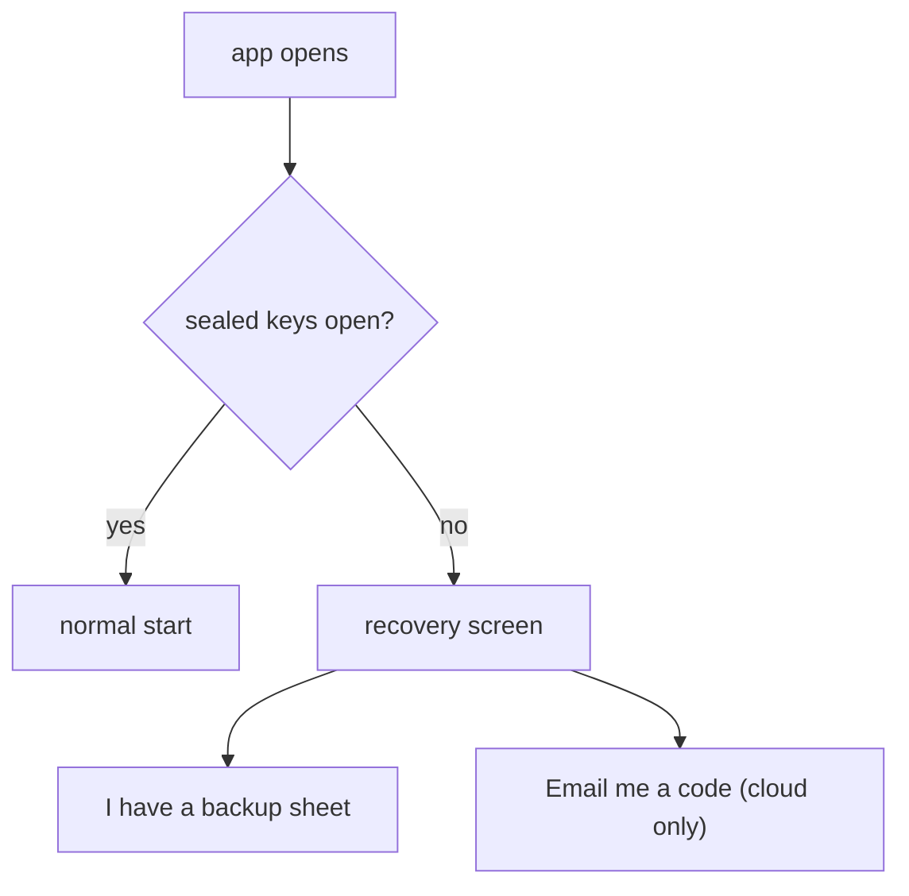

# 0328: In next/, a lost device comes back by a 12-word sheet or, on the cloud, by email, and a device whose keys did not come across goes to recovery, never to a new founding

**What this decides:** which ways back a person gets after losing a device, for each setup.

## Context

Tier 1's P5, the backup's design pass. From
[account recovery](../docs/direction/recovery-key.md#which-way-for-which-setup), decided by the
owner 2026-11-06. It is about `next/` only.

## Decision

**Two ways back, and the person picks: the sheet, or email on the Cloudflare setup.**

| Setup | Way back after a lost device | What setup says |
|---|---|---|
| Cloudflare | The sheet, at once; or email, after its wait ([0338](0338-email-recovery-waits-a-day.md)) | Both are offered |
| Local, with Time Machine | Restore; if the keys did not come across, the sheet | The sheet is offered |
| Local, no copy | None | One plain warning, once, at setup |

- No third way that combines the sheet and email: the sheet alone is already instant.
- A device whose sealed keys did not come across goes to the recovery screen, never to a new
  founding, and never makes new keys by itself.
- A calm move to a new Mac needs neither way: Migration Assistant most likely carries the keys, and
  any device the person owns can let in another ([0333](0333-every-device-is-an-equal-person-key.md)).

## Consequences

- The founding screen gains "I have a backup sheet", and the local warning shows once.
- Today's version is not changed.
