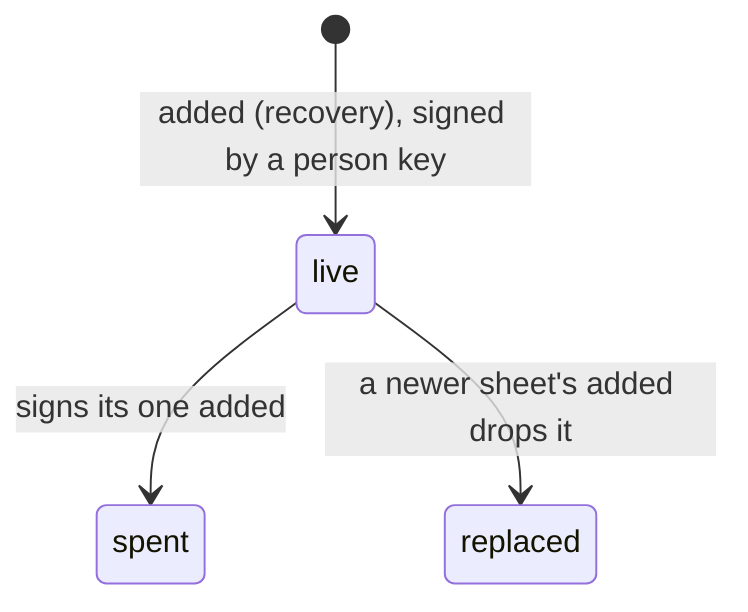

# 0331: In next/, a sheet recovery takes effect at once with no wait and no passphrase, a recovery key signs one `added` and is spent, and a new sheet kills the old one

**What this decides:** when a sheet's recovery takes effect and how many times one sheet works.

## Context

From [account recovery, calls 2 and 6](../docs/direction/recovery-key.md#2-no-wait-and-no-passphrase-decided),
decided by the owner 2026-11-06. The `spent` and `replaced` states are built in
`next/packages/libfabrika/src/access/Access.ts`.

## Decision

**A sheet works at once, and only once.**

- No wait before a sheet recovery takes effect, ever. Products whose recovery secret is a strong key
  do not wait; a wait fits only weak proof, such as email.
- No passphrase on top of the sheet: a forgotten one would make the sheet useless when it is needed.
- A recovery key signs one `added` and is then spent, by a rule in the fold, with no second event.
  The fold refuses anything it signs after, with the reason `used`.
- Making a new sheet kills the old one in the same `added`, in its `drops`, and the screen says so
  before the person confirms. A sheet a newer one ended is refused with `replaced`.
- Copies of one sheet are fine, since they are the same words.

## Consequences

- What the gateway answers a refused sheet is [0337](0337-a-new-device-reads-before-recovery.md)'s rule.
- The guards on this path are the ones in [0335](0335-the-sheet-is-printed-words.md) and
  [0336](0336-a-recovery-ends-by-counting.md): where not to keep the sheet, and the old device told
  at once.
