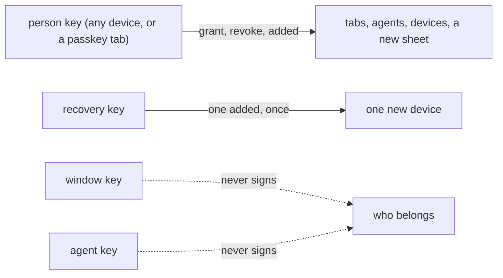

# 0333: In next/, every device the person owns is an equal person key that may let in and remove any other, an agent never is one, and a browser tab is one only with a passkey made with user verification

**What this decides:** which key may sign which change to who belongs.

## Context

From [account recovery, call 7](../docs/direction/recovery-key.md#7-who-may-sign-what-decided),
decided by the owner 2026-11-06. The passkey rule replaced the note's 70% lean on 2026-11-07, as
[Tier 1's question 19](../docs/plan/tier-1.md#open-questions) records. Built in
`next/packages/libfabrika/src/access/`.

## Decision

**Every device is a master, as on Apple and Keybase. The sheet is the backstop.**

- A person key may let in tabs, agents and other devices, remove any of them, and make a new sheet.
  Each device has its own person key, and they are equal. Any live person key may add or drop
  another; no rule stops one device from adding a device.
- An agent is never a person key and can never let anyone in.
- A browser tab approves only when the approval is signed by a passkey (WebAuthn) made with user
  verification required. That tab is a person key. A tab with only its window key never approves.
- Synced passkeys are accepted, and the grant records the passkey's backup flags (decided
  2026-11-08).
- A recovery key may let in one new device and drop keys, once. It never signs a grant or a revoke.
- A window key or an agent's key never signs an `added`, a grant or a revoke.
- The gateway checks every one of these with the same SSHSIG function, on the same route.

## Consequences

- A second device while the first lives comes in by one Approve, and spends no sheet.
