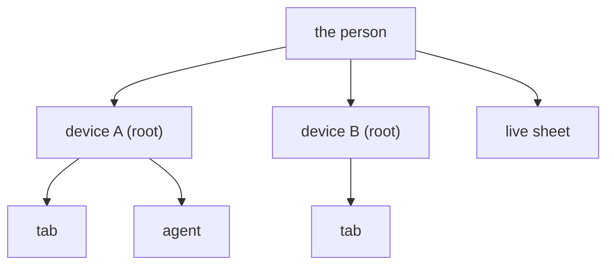

# 0334: In next/, a dropped key drops everything it let in, all the way down, while the person's devices are equal roots and the sheet belongs to the person, never to a device



```ts
// What the fold keeps per key. `under` names the key that let it in; null for a root.
type Member = { readonly rank: Rank; readonly live: boolean; readonly under: string | null };
readonly keys: ReadonlyMap<string, Member>;
```

**What this decides:** what else stops when one key is dropped.

## Context

From [account recovery, call 8](../docs/direction/recovery-key.md#8-how-foundedkeys-folds-with-added-and-the-grant-tree),
decided by the owner 2026-11-06. The grant tree is folded in
`next/packages/libfabrika/src/access/AccessFold.ts`.

## Decision

**Dropping a key drops its subtree, for a recovery and for Remove alike.**

- A key is admitted only while every key above it is live.
- Every device of the person is a root, however it came in. A device never hangs under another
  device, so dropping one never drops another. A device is dropped only by name.
- Only tabs and agents hang under a device, the one whose person key let them in, and drop with it.
- The sheet belongs to the person. Removing a device leaves the live sheet alone; only using it or
  making a new one ends it. A spent sheet's device stays in.
- A dropped key stays out forever. A later `added` cannot bring it back.
- The rule holds at any depth, so a later approver or an invite needs no new rule.

## Consequences

- The recovery screen lists what will drop with the old device: its own tabs and agents, never the
  person's other devices.
- What was already written stays: a note's `by` is still the old key.
