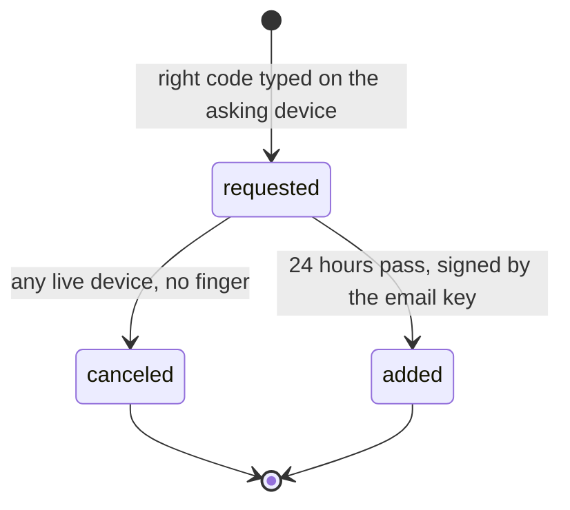

# 0338: In next/, email recovery on the cloud sends a 6-digit code typed on the asking device and waits 24 hours that any live device can cancel, then one brain-held key signs the `added`



```ts
// The event names are decided; their fields are a sketch.
{ _tag: "verified", email: "<address>", signed: sshsig(personKey) } // at setup
{ _tag: "requested", id: "rq-1", email: "<address>", adds: { _tag: "person", key, window }, drops }
{ _tag: "canceled", request: "rq-1", signed: sshsig(personKey) }
{ _tag: "added", add: { saw: { how: "email" } }, signed: sshsig(emailKey) } // on the alarm
```

**What this decides:** how the email way back works, for the Cloudflare setup only.

## Context

From [account recovery, email recovery](../docs/direction/recovery-key.md#email-recovery-decided-two-unknowns-open),
decided by the owner 2026-11-05 and 2026-11-06 after experiment 217. The mail route was widened on
2026-11-08 ([what is decided](../docs/direction/recovery-key.md#what-is-decided-and-what-is-open),
[Tier 3's mail](../docs/plan/tiers.md#tier-3s-address-mail-recovery-and-join-screen-owner-2026-11-08)).
Tier 1's P36 builds it.

## Decision

**Email is weak proof, so it waits a day, and every live device can stop it.**

- A 6-digit code, never a link, typed on the device that asked.
- The code is good for 10 minutes and 5 tries, then a new one. Only its hash is kept, never in the
  ledger.
- Every live device is told at once, with a Cancel button. Cancel needs no finger.
- The wait is 24 hours. The "lost or stolen?" answer is asked at once and its drops apply only when
  the wait ends, so a cancel also keeps the old device in.
- Setup records which address and when it was checked, as a `verified` event. A later recovery
  trusts only an address on the ledger before the loss. The events are `verified`, `requested` and
  `canceled`.
- The brain holds one email key whose only job is to sign the final `added` of a device after the
  wait. Its public half is on the ledger, and it never leaves the brain.
- Recovery mail goes to any friend: Email Sending on the group's own domain, or Access's one-time
  PIN on `workers.dev` alone. The install sets up the address, the DNS and the mail route through
  Alchemy, with no steps by hand (2026-11-08).

## Consequences

- The gateway keeps its one signature check: the last `added` is signed like any other.
- Not decided here: whether the no-domain route works, and whether the code reaches the inbox. The
  first build tries both.
