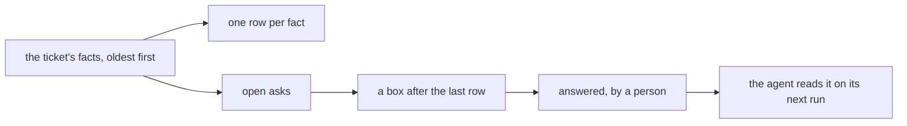

# 0341: A ticket's window is its timeline, every fact oldest first, with each open ask as a box only a person answers

**What this decides:** a ticket shows as one list of its facts, oldest first, and anything that
waits on a person shows as a box after the last entry that only a person can answer.



```ts
// The window: every fact, oldest first, then a box for each ask still open.
const view = (facts: TicketFact[]) => [...facts.map(row), ...openAsks(facts).map(box)];
```

## Context

The owner decided this on 2026-10-24
([tickets start in our tracker](../docs/direction/tickets-start-in-our-tracker.md#what-was-decided)).
GitHub's pull request page and its deployment review box work the same way.

## Decision

**A ticket's window is its timeline, and an open ask is a box at its end that a person answers.**

- Every fact about the ticket shows in one list, oldest first: filed, edited, comments, each step's
  answer. It is the one place to see what is being done.
- An open ask (plan, stuck, ruling, check) shows as a box after the last entry.
- The answer is a fact on the ticket. The agent reads it when it next runs, so the work between a
  person and the agents is async.
- Only a person answers, never an agent. The box is one way in; an answer said in a chat with the
  person's own session, or in `next/` a line in a lane's room
  ([0073](0073-a-lane-has-a-room.md)), is the same `answered` fact.

## Consequences

- An agent cannot approve its own plan or answer its own ask.
- The "never in a chat" wording of the 2026-10-24 note is replaced by the chat answer of
  [one ask and one meter](../docs/direction/one-ask-and-one-meter.md) (2026-10-30); the answer is
  still a person's fact.
