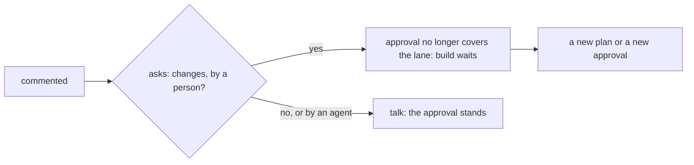

# 0342: A comment is talk and never changes what an approval covers, and only a person's request for changes stops build

**What this decides:** a plain comment leaves an approval in place, an approval or a ruling is a
fact of its own, and a person who picks "Request changes" after an approval stops the build.



```ts
{type: "commented", ticket: "demlik-1", by: "owner", body: "Skip part 2.", asks: "changes"}
// the approval before it no longer covers the lane; build waits for a new plan or a new approval
```

## Context

The owner decided this on 2026-10-24, for the first version
([tickets start in our tracker](../docs/direction/tickets-start-in-our-tracker.md#what-was-decided)).
Today's tracker and ticket programs build it (`asks: "changes"` on the `comment` input,
`packages/pipeline/src/tickets/approval.ts`).

## Decision

**A comment is talk; an approval or a ruling is an answer in a box, a fact of its own.**

- A comment never changes what an approval covers.
- The comment form has two buttons, "Comment" and "Request changes", as GitHub's review box does.
  The person says which, so nothing guesses.
- A person's "Request changes" after an approval stops build and asks for a new plan or a new
  approval.
- An agent's request for changes never stops anything.

## Consequences

- A person who picks "Comment" by habit leaves the approval in place. How often that hides a change
  of mind is not measured.
