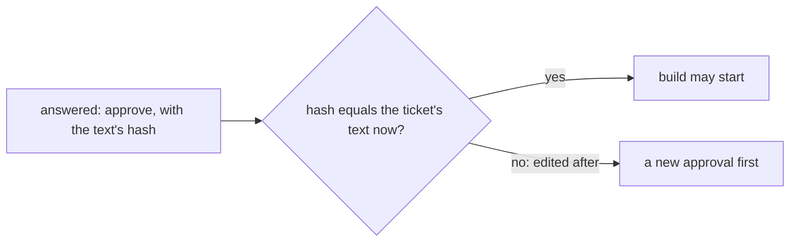

# 0343: An approval covers the text it saw, a hash of the ticket's title and body, so an edit after it needs a new approval before build

**What this decides:** an approval records a hash of the ticket's title and body, and once the
text changes the approval no longer covers it.



```ts
// A JSON pair, so "ab" + "c" and "a" + "bc" do not share a hash (experiment 138).
const covers = (approval: Approved, now: Ticket) =>
  approval.text === sha256(JSON.stringify([now.title, now.body]));
```

## Context

The owner decided this on 2026-10-24
([tickets start in our tracker](../docs/direction/tickets-start-in-our-tracker.md#what-was-decided)).
GitHub can mark an approval stale when a diff changes, and Gerrit drops a vote on a new patch set.
Today's code holds it in `packages/pipeline/src/tickets/approval.ts`, with Web Crypto's SHA-256.

## Decision

**An approval names the text it saw, and an edit after it is not covered.**

- The approval stores a hash of the JSON pair `[title, body]`.
- An edit to the title or the body after the approval needs a new approval before build starts.

## Consequences

- A small edit costs a second approval. That is the price of never building text nobody approved.
