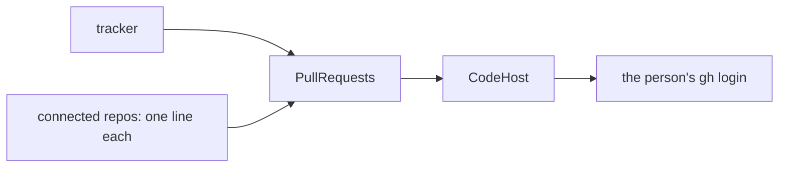

# 0345: The tracker is tied to no repository, and GitHub is one integration of it, read through CodeHost on the person's own gh login

**What this decides:** the tracker stands on its own, and reaches GitHub only as an integration
that uses the pipeline's one GitHub client and the person's existing login.



```ts
// Today's version. programs/tracker/src/github.ts holds the list:
export const GITHUB: GitHubSettings = { repos: ["https://github.com/<owner>/<repo>"], under: [...] };
// apps/fabrika/src/host/main.ts reads pull requests through CodeHost, on the gh login:
const pullRequests = Layer.provide(gitHubPullRequests(GITHUB), gitHubCodeHost({ own: [], reviewers: [] }));
```

## Context

The owner decided this on 2026-10-26, as Linear does it
([tickets start in our tracker](../docs/direction/tickets-start-in-our-tracker.md#decided-2026-10-26-github-is-an-integration)).
Today's tracker builds it in `programs/tracker/src/github.ts` and `apps/fabrika/src/host/main.ts`.

## Decision

**Tickets live on the ledger, and GitHub is one integration of the tracker's own.**

- The tracker is tied to no repository.
- The integration reads through `CodeHost`, the pipeline's one GitHub client, on the person's own
  `gh` login. There is no second GitHub client and no token: the tracker never holds one, and its
  window never sees one.
- Connected repositories are a list in the integration's settings. Adding one is one line.

## Consequences

- One GitHub client means one place for auth, rate limits and GitHub's shapes.
- The app needs `gh` on its path and logged in. Without it, the list says it could not read pull
  requests, and tickets work as before.
