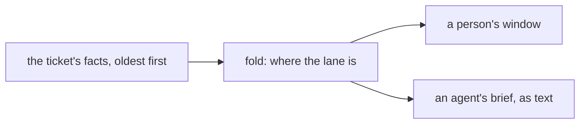

# 0347: Every piece of a lane's work is a fact on its ticket, the ticket's state is their fold, and people and agents read the same timeline

**What this decides:** a ticket is the one stream a lane writes to, its state is worked out from
that stream, and a person's window and an agent's brief are two views of the same fold.



```ts
const facts = ledger.entries({ ticket: "demlik-1" }); // oldest first
const state = facts.reduce(step, empty); // where the lane is now
const forPerson = view(state, facts); // rows, then a box for each open ask
const forAgent = brief(state, facts); // the same rows as text
```

## Context

The owner decided this on 2026-10-24
([the ticket is the lane view](../docs/direction/the-ticket-is-the-lane-view.md#what-was-decided)).
It is event sourcing, as GitHub's pull request page is for code. The note is walked for `next/`
when Tier 6 starts; there a fact is an event.

## Decision

**The ticket ties the lane together.**

- Every piece of a lane's work is a fact on its ticket: filed, edited, comments, triage's answer,
  the plan, each build commit, each review, the pull request's status, each ask and its answer.
- The ticket's state is the fold of those facts. Nobody writes it.
- Its timeline is the app's most important window: there a person sees where the lane is and what
  waits on them.
- An agent working the lane reads the same timeline a person reads, as text. Triage reads it
  whole, comments included.
- Each fact says who wrote it, a person or an agent, so the two look different in both views. Only
  a person's answer closes an ask
  ([tickets start in our tracker](../docs/direction/tickets-start-in-our-tracker.md#what-was-decided)).

## Consequences

- Two views, the window and the brief, must keep in step with every new kind of fact.
- A long lane makes a long timeline. How a brief cuts old rows is not designed.
- The more an agent reads, the more text could steer it; only ledger members write, and each fact
  names its writer.
