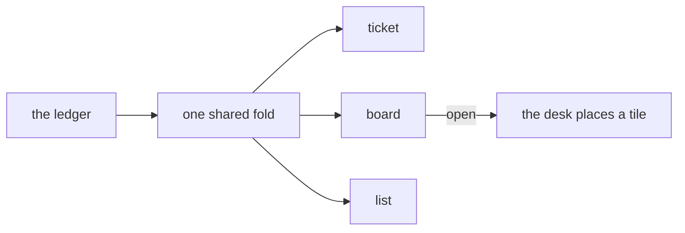

# 0350: Each tracker view is its own program, sharing only the ledger and one fold, never one tracker program

**What this decides:** the ticket page, the board and the list are separate programs that meet
only at the ledger and a shared fold.



```text
ticket --ticket 43     one ticket: a status line, properties, sub-issues, activity
board --under 70       the parent's children as cards, one column per state
list                   today's tracker list
```

## Context

The owner decided this on 2026-11-06, in the product talk
([tracker views are programs](../docs/direction/tracker-views-are-programs.md#one-program-per-view-sharing-only-the-ledger-decided-2026-11-06)).
It follows CQRS, where each view is a read model, and Elm Land's shared model. The rest of that
note stays proposed outside its decided parts. It is walked for `next/` when Tier 2 starts.

## Decision

**Board and list views, and the ticket page, are their own programs.**

- They share only the ledger and one fold. No view holds another's state.
- Each view starts alone from the shell and is tested alone.

## Consequences

- Each view folds the whole ledger and polls it: small at hundreds of tickets, not at tens of
  thousands. Three views at once is to be measured for start time and memory.
- Which views come first, and the board's column fold, are still proposed in the note.
