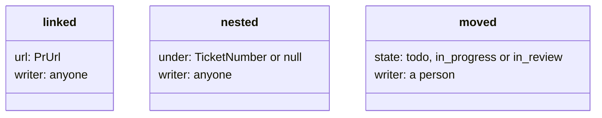

# 0351: The tracker's first three new facts are linked, a pull request's URL, nested, a parent anyone may write, and moved, open states only

**What this decides:** a ticket gains a fact that links a pull request, one that puts it under a
parent, and one that moves it between open states, and none of them can say done.



```ts
// A sketch, from the note. Done and closed are not open states, so moved cannot spell done.
const OpenState = Schema.Literals(["todo", "in_progress", "in_review"]);
Schema.Struct({ type: Schema.Literal("linked"), url: PrUrl }); // its state comes from GitHub
Schema.Struct({ type: Schema.Literal("nested"), under: Schema.NullOr(TicketNumber) });
Schema.Struct({ type: Schema.Literal("moved"), state: OpenState });
```

## Context

The owner decided these three on 2026-11-06, as the note writes them
([tracker views are programs](../docs/direction/tracker-views-are-programs.md)). In `next/` each is
an event with `_tag`. The later facts the note lists (`related`, `due`, `prioritized`, `labeled`)
are not decided here.

## Decision

**`linked`, `nested` and `moved` are the tracker's next facts.**

- `linked` names a pull request's URL, never its state. Its state, checks and reviews are read
  from GitHub by code, through `CodeHost`, never typed by an agent.
- Anyone on the ledger may write `nested`, an agent's plan step included, so a plan can file its
  slices under its ticket.
- The list and the board each have a display option that hides sub-tickets, as Linear's "Show
  sub-issues" does.
- `moved` holds only the open states todo, in progress and in review, so it can never spell done.
  There is no backlog state.

## Consequences

- A check's color is GitHub's word, never an agent's.
- What the fold refuses for each fact (a loop, a missing parent, a `moved` on a closed ticket) is
  still the note's proposed section 8.
