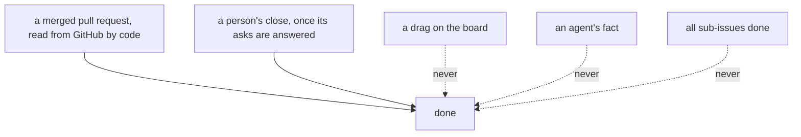

# 0352: A ticket's status is a fold of its facts, and done comes only from a merged pull request read by code or a person's close, never a drag, an agent or a sub-issue count

**What this decides:** nobody writes a ticket's status or its done; both are worked out from the
facts, and done has only two sources.

## Context

On 2026-11-06 the owner decided that status, done included, is a fold of facts
([tracker views are programs](../docs/direction/tracker-views-are-programs.md#4-where-135-and-153-clashed-and-how-this-note-settles-it),
as [label guidelines](../docs/direction/label-guidelines.md) records it). Where done comes from was
decided on 2026-10-25 ([what a ticket shows](../docs/direction/what-a-ticket-shows.md), section 5)
and is restated there. [0015](0015-a-pr-phrase-closes-its-tickets.md) decides which tickets a
merged pull request closes; this file decides that status is never a stored field.

## Decision

**Status is a fold, never a fact anyone writes.**

- A person may move an open ticket between open states with `moved`, which cannot spell done.
- Done comes only from a merged pull request read by code, or from a person's close once the
  ticket's asks are answered.
- No drag, no agent and no count of done sub-issues says done.

## Consequences

- How the board's column folds a person's `moved` with the lane's facts is still the note's
  proposed section 8.
- A parent closing itself when its children are done is not decided.
