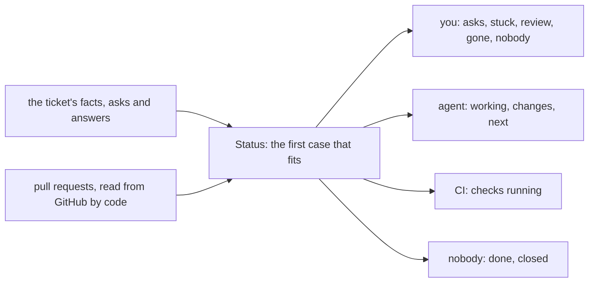

# 0353: A ticket's page leads with one status line that says whose turn it is, a fold of facts, asks and answers included, never a field anyone writes

**What this decides:** the first thing on a ticket's page is one sentence saying whether it needs
you and, if not, who has it, worked out from the facts.



```ts
// A sketch from the note, with today's names updated: the glossary calls the line Status, and
// 0081 turns `why` into `reason`. `prs` is what code read from GitHub, never what an agent wrote.
const Status = Schema.Union([
  Schema.TaggedStruct("done", { pr: Schema.NullOr(Url) }),
  Schema.TaggedStruct("closed", { by: Writer }),
  Schema.TaggedStruct("asks", { asks: Schema.NonEmptyArray(OpenAsk) }),
  Schema.TaggedStruct("stuck", { step: Step, reason: Schema.String }),
  Schema.TaggedStruct("working", { step: Step, since: Schema.Finite, by: Writer }),
  Schema.TaggedStruct("ci", { pr: Url, says: Schema.Literals(["failed", "running"]), checks: Counts }),
  Schema.TaggedStruct("review", { pr: Url, checks: Counts }),
  Schema.TaggedStruct("changes", { since: Schema.Finite }),
  Schema.TaggedStruct("next", { step: Step }), // only when a lane drives the ticket
  Schema.TaggedStruct("gone", { step: Step, since: Schema.Finite }),
  Schema.TaggedStruct("nobody", {}),
]);
```

## Context

The owner decided this on 2026-11-06
([tracker views are programs, 5.1](../docs/direction/tracker-views-are-programs.md#51-the-status-line-whose-turn-it-is)).
It replaces today's seven-branch top line, which said "next: triage" on tickets no lane drives.
The rest of the page's parts (5.2 to 5.6) stay proposed.

## Decision

**The status line answers one question: does this need me, and if not, who has it.** The first
case that fits wins:

| Case | Line | Whose turn |
|---|---|---|
| a merged pull request | Done: PR #155 merged | nobody |
| closed, not done | Closed by owner | nobody |
| an ask is open | Needs your answer: approve plan v2 | you |
| the last run ended `stuck` | Stuck: needs your answer | you |
| a run started and not ended | Agent working: build, 12 min | agent |
| a linked pull request, checks failed | CI failed on PR #156 | agent if a lane drives it, else you |
| a linked pull request, checks running | Waiting on CI: PR #156, 2 of 4 done | CI |
| checks passed, no person's review | Ready for your review: PR #155 | you |
| a person asked for changes since the last run | Changes asked: waiting on the agent | agent |
| a lane drives it, the last run sent on | Next: review | agent |
| a started run whose process is gone | Agent stopped without ending | you |
| nobody on it | No one on it yet | you |

- Whose turn it is stays a fold of the facts, asks and answers included, never a field anyone
  writes.
- "Next: <step>" shows only on a ticket a lane drives, never on one no lane drives.
- "Ready for your review" holds until a person's review or request for changes lands, never an
  agent's.
- The line takes the color of whose turn it is, and nothing else on the page is colored. Color is
  never the only cue: the words say it too.
- The list and the board show the same line, short.

## Consequences

- An agent cannot forget to hand a ticket back: no field holds the turn.
- A `CodeHost` read per open ticket with a pull request.
