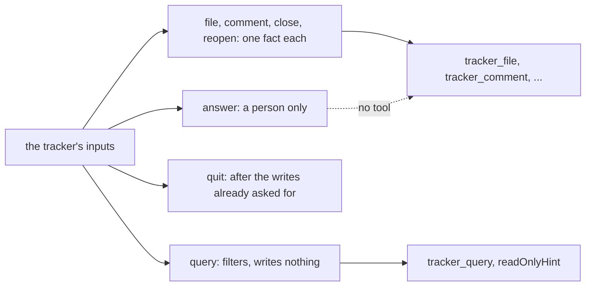

# 0355: A program has one input per command, named by its verb and writing one fact, one query input that writes none, and its own quit

**What this decides:** each command is its own input and its own MCP tool, every read goes through
one `query` with filters, and a person-only input makes no tool.



```ts
// Today's tracker (programs/tracker/src/index.ts), trimmed.
inputs: {
  file: input(File, "File a new ticket. Writes its `filed`."),
  close: input(OneTicket, "Close a ticket. Writes its `closed`."),
  answer: input(Answer, "...", { personOnly: true }),
  query: input(Query, "...", { writes: false }),
  quit: input(Schema.Null, "Stop, once every write told before it is on the ledger."),
}
// MCP: tracker_file, tracker_close, tracker_query (readOnlyHint), tracker_quit. No tracker_answer.
```

## Context

The owner decided this on 2026-10-28, keeping the 2026-10-27 split of writes from reads and
dropping its two inputs `write` and `view`
([tracker views are programs, section 7](../docs/direction/tracker-views-are-programs.md#7-inputs-one-per-command-and-one-query-decided-2026-10-27-changed-2026-10-28)).
A first build that kept one `do` input holding a union of every command was wrong and was undone
on 2026-10-30. Today's tracker follows this. In `next/`, an input says person-only with
`personOnly: true` ([a program's shape](../docs/direction/program-shape.md)).

## Decision

**One input per command, one `query`, and `quit`.**

- Each command is its own input, named by its verb (`file`, `comment`, `close`, `reopen`,
  `answer`), and writes one fact. Its value is the command's own struct, with no case key. Never a
  `do` union and never one `write` input.
- One `query` input with filters serves every read and never writes a fact. Its MCP tool carries
  `readOnlyHint: true`.
- `quit` is its own input. It stops the program only after the writes already asked for.
- A program's MCP tool names follow from its input names: `tracker_comment`, `tracker_query`.
- An agent's program list never holds `answer`: a person-only input makes no tool, so an agent
  cannot even call it.

## Consequences

- This is today's version. In `next/`, "input" means a write only, so a read is not a `query`
  input there: a read port gets its own word, picked with the first program that needs one
  ([a program's shape](../docs/direction/program-shape.md), 2026-11-08). The rest is walked for
  `next/` when Tier 2 starts.
- Order across inputs comes from each run's one mailbox, served in order, not from one input.
- Whether one query shape can grow to a notebook's filters without becoming its own small language
  is not known.
