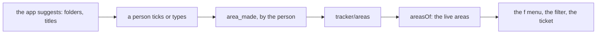

# 0356: In today's tracker, an area is a person's data on the project's ledger, held by number, never a list in the program and never read from folders

**What this decides:** a person makes, renames and merges the project's areas as facts on their
own stream, and the app only suggests them.



```ts
// Today's version: packages/pipeline/src/tickets/area.ts
export const AreaFact = Schema.TaggedUnion({
  area_made: { area: AreaNumber, name: AreaName, suggested: Schema.optionalKey(Suggested) },
  area_renamed: { area: AreaNumber, name: AreaName },
  area_merged: { area: AreaNumber, into: AreaNumber },
});
```

## Context

The owner decided this on 2026-11-04, call 5 of the areas walk, with the smaller calls 1 and 7 the
same day ([areas, A1](../docs/direction/areas.md#a1-an-area-is-a-persons-data-on-the-projects-ledger),
[the shape](../docs/direction/areas.md#the-shape)). It is today's version: `programs/tracker` and
`packages/pipeline/src/tickets/area.ts` build it. In `next/`, Area is the first label group
instead ([label guidelines](../docs/direction/label-guidelines.md)).

## Decision

**An area is a person's data on the project's ledger.**

- The list of areas is folded from the `tracker/areas` stream. The program holds no list, and no
  area is read from folders.
- A person makes, renames and merges areas, from the shell's inputs (`make_area`, `rename_area`,
  `merge_area`) and from the `f` menu's rows. Both are the same inputs.
- A ticket holds an area's number, never its name, so a rename touches no ticket and a merge moves
  every ticket at once.
- The area facts and `area_picked` are a person's kinds, refused when an agent writes one. An agent
  that files may still write its guess on `filed`.
- The app suggests areas, from folders, pull request files and past tickets, but never sets one.
  The fact keeps what the person was shown, as `suggested`.
- Picking the first areas is a step of the tracker's onboarding. With no area on the ledger, the
  tracker opens on a checklist of suggestions in the list page. Skipping it is the person's window
  state, never a fact.

## Consequences

- When `next/` takes the tracker over, each area becomes a label in the Area group with the same
  number, and that pull request deletes today's area code.
- Until the desk keeps window state, the skip lives in the tracker machine's own state (tracker
  ticket 217).
