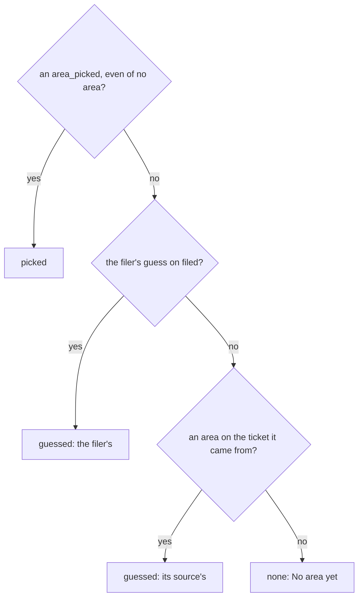

# 0357: In today's tracker, a ticket's area is a guess until a person picks, the guess shows as a guess with its source, and the app never writes a pick

**What this decides:** a ticket's area is worked out in a fixed order, a person's pick first, and
every guess is marked as one until a person picks.



```ts
// A sketch from the note, with `why` renamed `reason` (0081). A fold; nobody writes it.
const TicketArea = Schema.Union([
  Schema.TaggedStruct("picked", { area: Schema.NullOr(AreaNumber) }), // the last pick wins
  Schema.TaggedStruct("guessed", { area: AreaNumber, reason: Schema.Literals(["filer", "source", "judge"]) }),
  Schema.TaggedStruct("none", {}),
]);
```

## Context

The owner decided this on 2026-11-04, call 5 and smaller call 3
([areas, A2](../docs/direction/areas.md#a2-a-tickets-area-is-a-guess-until-a-person-picks-and-the-guess-says-so),
[the shape](../docs/direction/areas.md#the-shape)). Linear's triage suggestions sit beside the real
value until a person accepts. It is today's version.

## Decision

**A ticket's area is a guess until a person picks.**

- A person's pick wins, even a pick of no area. Else the filer's guess. Else the area of its source,
  through `from`. Else none.
- A guess shows as a guess, with its source ("the filer's", "its source's"), on the ticket and in
  the row.
- The mark is a "?" after the name, a shape cue, never color alone. The row's accessible name says
  "a guess". It goes once a person picks.
- The app never writes a pick. An `area_picked` an agent writes is refused.

## Consequences

- Most tickets are filed by an agent, so showing the guess in place keeps them out of "No area yet".
- Whether a "?" on most rows reads as calm or noisy is left to the build's shots. A screen reader
  run is owed.
