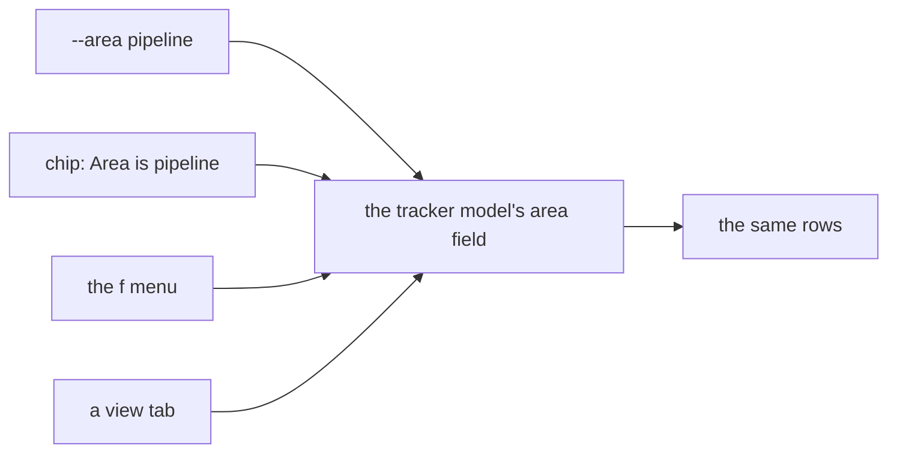

# 0358: In today's tracker, narrowing to an area is one filter field that every door sets, and grouping by area is a Display option of the same list

**What this decides:** the flag, the chip, the `f` menu and a view tab all set the same `area`
field, and grouping is an option of the list, never a separate view.

## Context

The owner decided this on 2026-11-03, picking design B3 with B1's grouping kept as an option
([areas, A3](../docs/direction/areas.md#a3-narrowing-is-one-filter-with-three-doors-and-no-area-yet-is-one-of-its-values),
[A4](../docs/direction/areas.md#a4-grouping-is-a-display-option-of-the-same-list)). It is today's
version. In `next/`, `--area` stays as the Area label group's short form.

## Decision

**One filter, many doors, and one list.**

- `tracker --area pipeline`, the chip "Area is pipeline", the `f` menu and a view tab all set one
  field, `area`, in the tracker's model, with one Msg.
- For every area and every list, the doors give the same rows.
- "No area yet" is one of that field's values, for tickets whose area folds to none or to a pick of
  no area: `--area none` and the "No area yet" tab are the same filter (decided 2026-11-07).
- The chip's remove is a button named for the filter it removes.
- Grouping by area is a Display option of the same filtered list, never a separate view. Each group
  heading has a fold button, and "Fold all" and "Unfold all" sit under it. Grouped and ungrouped
  views hold the same tickets.

## Consequences

- Folds are model state, a set of area numbers; today a zoom rebuilds the window and drops them
  (tracker ticket 197).
