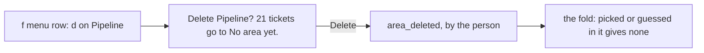

# 0360: In today's tracker, an area can be deleted as well as merged, its tickets go to No area yet, and the area_deleted fact is kept

**What this decides:** a person may delete an area, which moves its tickets to "No area yet"
without losing the history of where they were.



```ts
// A sketch from the note, today's version. One more person fact on tracker/areas.
Schema.TaggedStruct("area_deleted", { area: AreaNumber });
// areaOf(193) before: {_tag: "picked", area: 1}; after area_deleted {area: 1}: {_tag: "none"}
```

## Context

The owner decided this on 2026-11-07, changing the lean of "never deleted, only merged"
([areas, call 2](../docs/direction/areas.md#2-an-area-can-be-deleted-and-merged)). Jira's delete
offers the same. Today's version; it is not built yet (`packages/pipeline/src/tickets/area.ts`
has made, renamed and merged).

## Decision

**Both delete and merge stay.**

- A delete moves the area's tickets, picked or guessed, to "No area yet". A ticket needs no area.
- The menu row asks first, with the count of tickets that move.
- The ledger keeps the `area_deleted` fact, so history still shows a ticket's old area.
- The fold refuses a delete of an area that does not exist, is merged or is deleted already, and a
  merge into a deleted area.

## Consequences

- Labels in `next/` are archived, never deleted
  ([0366](0366-a-label-is-the-projects-number.md)). Which of the two `next/`'s Area group takes is
  not decided.
