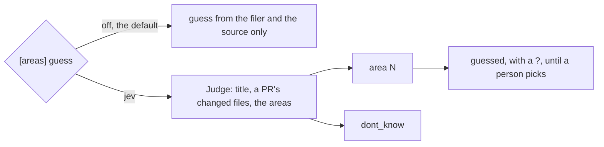

# 0363: In today's tracker, an area guess may come from a Judge classifier only as a project setting that is off by default, and it stays a guess until a person picks

**What this decides:** a small classifier may guess a ticket's area, but only when the project
turns it on, and its answer is a guess like any other.



```toml
# the project's settings, a sketch from the note
[areas]
guess = "off"   # or "jev": costs money and sends titles and file paths to Jev
```

## Context

The owner decided this on 2026-11-07, changing the lean of no classifier guess in v0
([areas, call 6](../docs/direction/areas.md#6-a-guess-may-come-from-a-small-classifier-off-by-default)).
Judge is the pipeline primitive that answers one narrow question. Today's version.

## Decision

**A Judge guess is opt-in, and it is still a guess.**

- The guess may come from Judge (Jev), given the ticket's title, a pull request's changed files
  when there is one, and the project's areas. It answers an area or "don't know".
- It is a project setting, off by default.
- Its answer shows with "?" until a person picks ([0357](0357-an-area-is-a-guess-until-picked.md)).
- Before it is ever on by default, it is measured on this repo's tickets against the areas people
  picked.

## Consequences

- With it off, guesses come from the filer and the source only.
- Turning it on costs money and sends titles and file paths to Jev.
