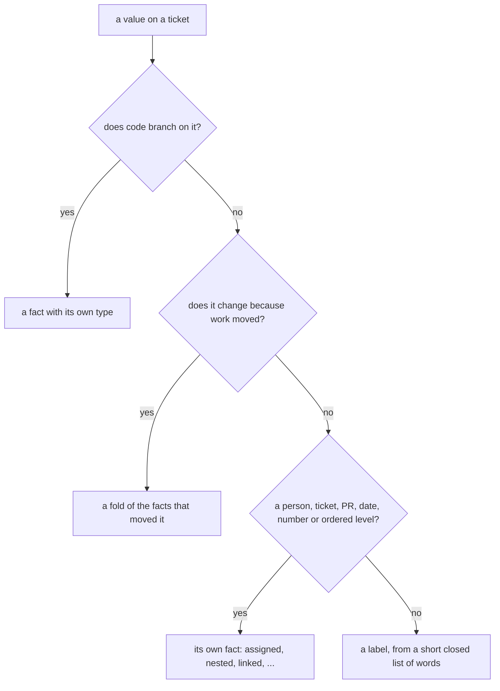

# 0364: In next/'s tracker, nothing decides on a label, and state that moves or a typed value is never a label but a fold or a fact of its own

**What this decides:** labels are for people to find, filter and group work; anything code
branches on, anything that goes stale, and anything with a type lives elsewhere.

## Context

The owner decided L1, L2 and L3 on 2026-11-06, with their leans of 90%, 90% and 85%
([label guidelines, L1](../docs/direction/label-guidelines.md#l1-nothing-decides-on-a-label),
[L2](../docs/direction/label-guidelines.md#l2-state-that-moves-is-a-fold-never-a-label),
[L3](../docs/direction/label-guidelines.md#l3-a-typed-value-is-a-field-or-a-link)). Kubernetes
labels "do not directly imply semantics to the core system". `next/`; today's areas already follow
it.

## Decision

**A label never decides, never moves and never holds a typed value.**

- No step, gate, lane, turn, notification or sort order branches on a label. No pipeline program
  subscribes to the labels stream.
- State that moves (status, done, whose turn, claimed, blocked, waiting on a person) is folded from
  the facts that moved it. The test: would it go stale if nobody touched it? Then it is not a label.
- A person, a ticket, a pull request, a date, a number or a level with an order is its own fact.
  Decided so far: `linked`, `nested`, `moved`, `assigned` and `delegated`. `related`, `due` and
  `prioritized` are decided with the slice that adds each.

## Consequences

- A lint rule: no pipeline step module imports the labels fold. A law: a step's answer is the same
  for a timeline with every `labeled` removed.
- A pack that wants to read a label gets a field it owns instead
  ([0367](0367-a-label-that-acts-graduates.md)).
- Priority as a field is the lean for its slice, not decided here.
