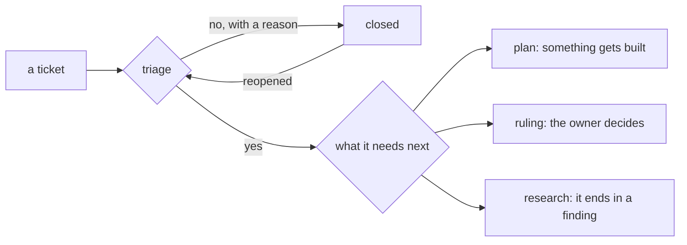

# 0372: Triage answers yes or no, never later, a snooze or a priority, every no carries its reason, and a yes says what the ticket needs next

**What this decides:** triage keeps a ticket or closes it with a reason, a "later" is only a
reopened no, and a kept ticket goes to a plan, a ruling or research.

## Context

The owner decided this on 2026-10-18, when the step was still called sort
([sort answers yes or no](../docs/direction/sort-answers-yes-or-no.md#what-was-decided),
[what it means for the work](../docs/direction/sort-answers-yes-or-no.md#what-it-means-for-the-work)).
It was renamed triage on 2026-10-24. Today's pipeline code still says sort
(`packages/pipeline/src/stages/sort/`); the rule is the design of `next/`'s triage too.

## Decision

**Yes or no, and a yes names its next step.**

- There is no "later", no snooze and no priority in triage's answer.
- Every "no" carries a one-line reason, such as "not now: nobody needs this yet", so a reader can
  tell which are worth bringing back.
- "Later" is a reopened "no": a reopen goes back through triage, which reads everything fresh. No
  separate path and no clock.
- Triage's duplicate check reads closed tickets too, reasons included.
- A "yes" says what the ticket needs next: `plan` (something gets built), `ruling` (the owner
  decides; it never reaches a builder) or `research` (it ends in a finding, not a pull request).
- An open question the plan can carry with a lean goes to `plan`, never to `ruling`.
- Bug urgency has no home in the core; it waits for an on-call pack.

## Consequences

- A "yes" is not approval to build ([0376](0376-only-an-approved-plan-starts-a-build.md)).
- Good tickets that stay closed because nobody reports them again would be the run that proves a
  "later" with a wake-up is needed.
