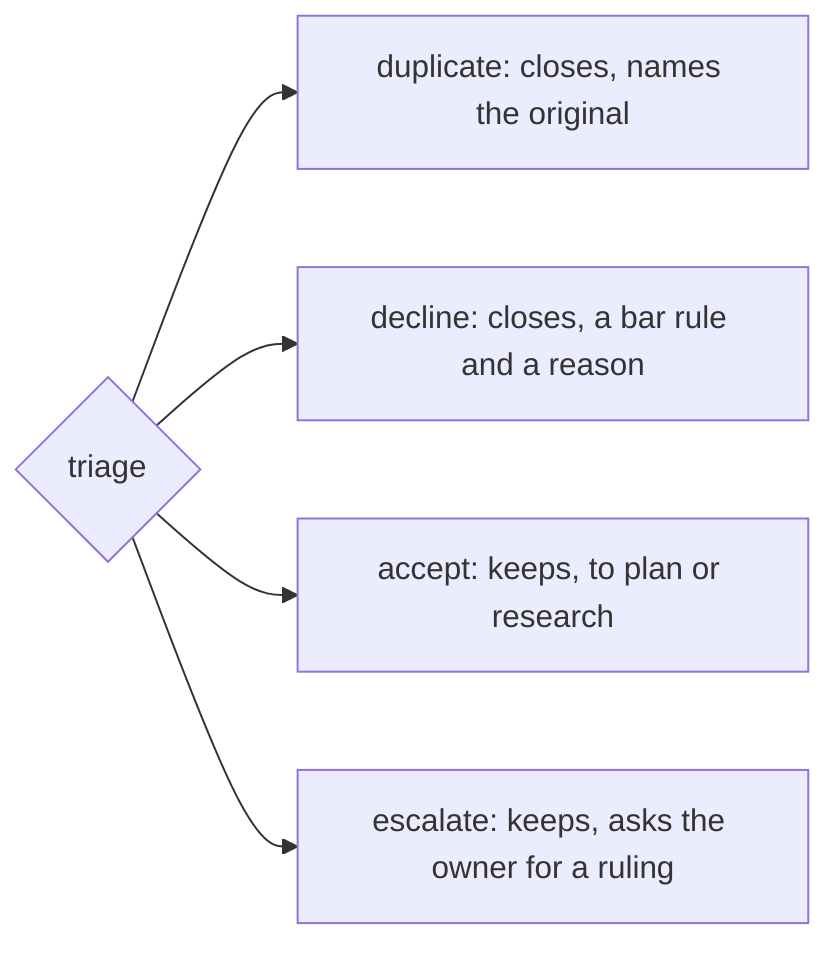

# 0373: Triage's answers are duplicate, decline, accept and escalate, named by what each does to the ticket, and triage does not fold for now

**What this decides:** the four words triage answers in, and that every yes needing a plan starts
a plan of its own.



```ts
// From the note; outcomes in the five verbs.
// outcomes: done:closed:declined, send:plan:accepted, send:research:accepted, ask:owner:ruling
```

## Context

The owner picked the names on 2026-10-24, in the words triage tools use: Linear's Accept, Decline
and Mark as duplicate, and the help desk's escalate. Fold was dropped the same day, from
experiment 133, where triage folded right 2 of 26 times
([sort answers yes or no](../docs/direction/sort-answers-yes-or-no.md#what-was-decided)).
Today's code is not renamed yet: it still says `no`, `yes` with `next`, and keeps `partOf`
(`packages/pipeline/src/stages/sort/answer.ts`).

## Decision

**One word per answer, by what it does to the ticket.**

- `duplicate` names the ticket it repeats as `original`. `decline` names a bar rule and a reason.
  Both close the ticket.
- `accept` sends it `to` `plan` or `research`. `escalate` asks the owner, with the options. Both
  keep it.
- The "yes" layer goes: the answer is the one word, and the outcome reuses it.
- Triage does not fold, for now. A yes never names an open plan to join (`partOf` goes). Every yes
  that needs a plan starts a plan of its own.

## Consequences

- The rename lands with the move from sort to triage, with fold and the bar's `carried` rule taken
  out in the same pass.
- In `next/`, the answer's free-text explanation key follows
  [0081](0081-no-question-word-names.md): never `why`. Its name, beside decline's `reason`, is the
  build's to pick.
- A batch of sibling tickets becomes one plan and one approval each. Batches that cost the owner
  real time, or sibling pull requests that keep fighting, would bring fold back.
