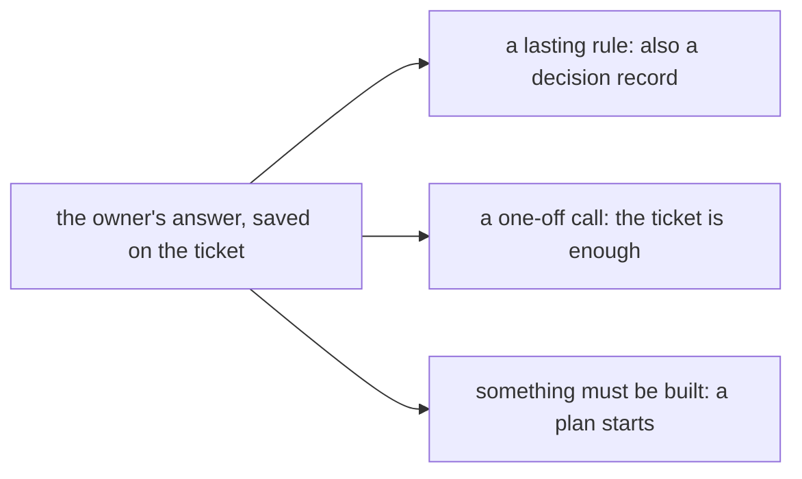

# 0375: A ruling that sets a lasting rule is also written as a decision record, a one-off call stays on the ticket, and a ruling that needs building starts a plan

**What this decides:** where the owner's answer to an escalated ticket goes, so the rules that
matter are not buried under small calls.

## Context

The owner decided this on 2026-10-18
([sort answers yes or no, the ruling route](../docs/direction/sort-answers-yes-or-no.md#the-ruling-route)).
For this repo's own decisions, [0001](0001-decisions-live-in-the-repo.md) already says each lands
in `.decisions/` the turn it is made; this file says the same of a ruling on any ticket triage
escalates.

## Decision

**A ruling ends with the owner's answer on the ticket, then takes one or more of three branches.**

- A lasting rule, how the code or product must work from now on, is also written as a decision
  record, so later agents read the why.
- A one-off call needs no decision record: the answer on the ticket is enough.
- If something must be built, the ruling starts a plan.

## Consequences

- Only lasting rules become decision records.
