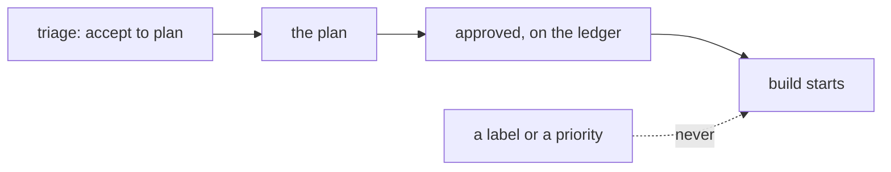

# 0376: Building starts only on an approved plan on the ledger, and no label, priority or triage yes ever gates a build

**What this decides:** the one go to build is the approval of a plan, recorded on the ledger.

## Context

The owner decided on 2026-10-18 that building is approved on the plan, the first point where what
would be built is clear, and on 2026-10-21 that labels never gate a build
([sort answers yes or no, who approves building](../docs/direction/sort-answers-yes-or-no.md#who-approves-building)).
[0346](0346-the-tracker-is-built-like-linear.md), the tracker built like Linear (2026-10-27), keeps
it as the tracker grows priorities and labels.

## Decision

**The approved plan on the ledger is the only go.**

- A triage "yes" is not approval to build; triage sees only the report.
- No label and no priority gates a build ([0364](0364-nothing-decides-on-a-label.md)).
- Who may approve which plan in this repo is AGENTS.md's rule; it is not restated here.

## Consequences

- An approval covers the text it saw ([0343](0343-an-approval-covers-its-text.md)), and a person's
  request for changes after it stops build ([0342](0342-a-comment-never-moves-an-approval.md)).
- How many people must look at the pull request is a separate floor
  ([0082](0082-approvals-is-a-floor-for-every-run.md)).
