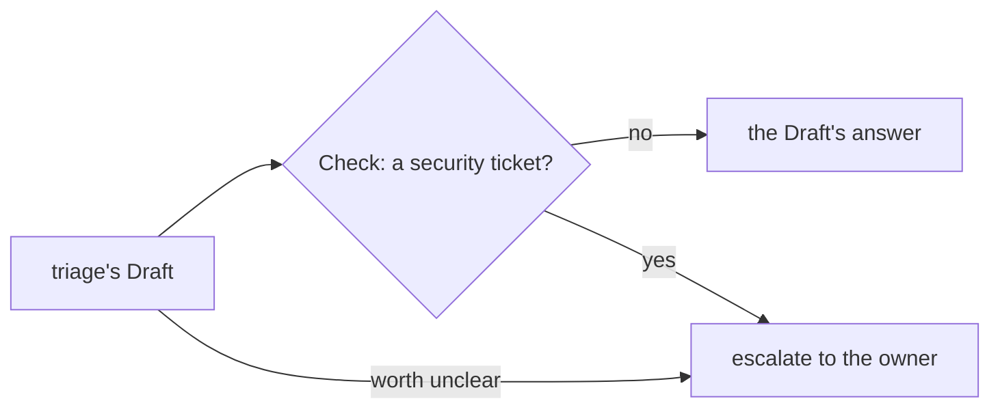

# 0377: When a ticket's worth is unclear, triage escalates to the owner, never keeps it and builds, and a security check turns any answer on a security ticket into an ask

**What this decides:** an unclear ticket costs the owner an ask, not a wasted build, and code makes
sure no security ticket is closed or kept without a person.

## Context

The owner decided this on 2026-10-30, picking option A of experiment 163 parts 4 and 5: about 130
to 190 asks a week with about 10% wrong keeps, over B's about 45%
([triage asks when worth is unclear](../docs/direction/triage-asks-when-worth-is-unclear.md#what-was-decided)).
The note's sketch says `close`, `keep` and `ask`; triage's answers are named
duplicate, decline, accept and escalate ([0373](0373-triage-answers-by-what-they-do.md)).

## Decision

**When worth is unclear, triage asks.**

- An unclear ticket is escalated to the owner. Triage never keeps it and builds.
- The ask budget is not fixed before triage runs on real tickets. It, and the choice between more
  asks and more wrong keeps, are measured on live weeks.
- A security Check after triage's Draft turns any answer on a security ticket into an escalate.
  It is the next triage piece to build.
- That check never reads a label to know a ticket is about security
  ([0364](0364-nothing-decides-on-a-label.md)).

## Consequences

- The note's numbers rewrote saved answers on seen sets; only a live week tells the real load.
- How a ticket is known to be about security, without a label, is not decided here.
- If asks pile up past what the owner answers, the note says to try keeping on one area at a time
  and count wasted pull requests.
