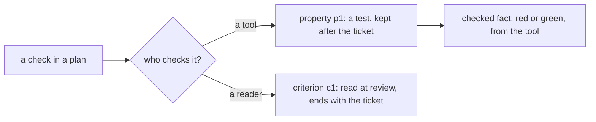

# 0380: A plan's property is checked by a tool and lasts as a test, and its criterion is read by a reviewer and ends with the ticket, never one check type for both



```ts
// A sketch, from the note. Ids come from the criteria book.
type Property = {
  id: PropertyId; // p1, p2, ...
  when: string;
  result: string;
  reason: string; // what goes wrong if it breaks
  behavior: "new" | "existing";
  tool: "test" | "tla";
  stories: readonly StoryId[];
  code: readonly { file: string; name: string }[];
};
type Criterion = { id: CriterionId; when: string; result: string; read: string; stories: readonly StoryId[] };
```

**What this decides:** the two kinds of check a plan holds, and what each one keeps.

## Context

From [the plan stage](../docs/direction/the-plan-stage.md#1-checks-split-by-who-checks-them),
decisions 1, 2, 3 and 5, all decided 2026-10-24. Nothing of it is built yet. The glossary rows
`property` and `criterion` use these words now, with `reason` for the note's `why`
([0081](0081-no-question-word-names.md)).

## Decision

**A check in a plan is a property or a criterion, split by who checks it.**

- A property is checked by a tool and lasts as a test after the ticket closes. A criterion is read
  by a reviewer at review, says in `read` what the reviewer reads, and ends with the ticket.
- There is no single `Check {how, what}` type for both. "Check" names only the pipeline primitive.
- A `new` property's test must fail on today's code first. An `existing` property's test must pass
  on it, and its `code` is what it pins.
- A property's tool word is `test` or `tla`. There is no `proof` or `property` tool word until
  something runs proofs.
- A property and a criterion name the stories they serve with the same key, `stories`, never
  `serves`.
- A property gets a lasting `p<n>` id, kept across plan revisions as a criterion's `c<n>` is.
- A property's result comes only from a tool, as a `checked` fact, never from a review row.

## Consequences

- Both versions' plan step take these shapes when they are built; `next/`'s pipeline is designed
  in [0059](0059-pipeline-starts-from-the-work.md)'s order, and these words are its input.
- Who picks the tool word is [0385](0385-tla-only-for-a-design-with-no-code.md).
- Not decided here: where a task lists its other properties and criteria, and whether a property's
  id outlives the ticket as a record's name.
