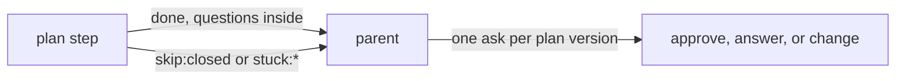

# 0382: The plan step has no ask of its own, so a plan with open questions ends done with them inside, and the parent asks for approval once per plan version



```ts
// A sketch of the plan step's words, from the note, in today's helper.
const plan = outcomesOf({
  done: {}, // the plan, its questions inside it
  skip: ["closed"],
  stuck: ["read_failed", "draft_failed", "over_budget", "unfixed", "cut_off"],
});
```

**What this decides:** how the plan step ends, and who raises the plan's ask.

## Context

From [the plan stage, decision 7](../docs/direction/the-plan-stage.md#7-plan-has-no-ask-of-its-own),
decided 2026-10-24. The lane already treated `done` and `ask:owner:questions` the same way.

## Decision

**The plan step answers only `done`, `skip:closed` or `stuck:*`, and the parent raises the ask.**

- `ask:owner:questions` goes. A plan with open questions ends `done`, with the questions inside
  the plan.
- The parent asks once per plan version: approve it, answer its questions, or change it.
- A plan with open questions always goes to the owner.

## Consequences

- In this repo's hand-run steps, AGENTS.md says who approves a plan: the lead, for a plan that only
  builds a decided note, and the owner for a new design call. This file does not change that.
- Not decided here: whether the owner's answer to the questions approves this version or starts a
  new one, and whether a plan that ends `stuck:unfixed` still writes `planned`.
